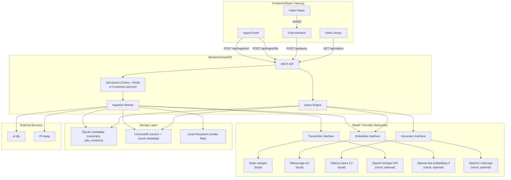
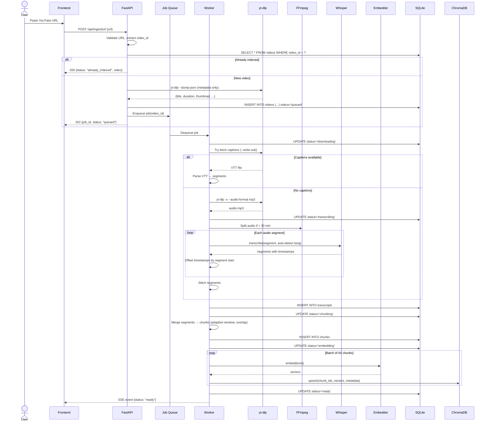
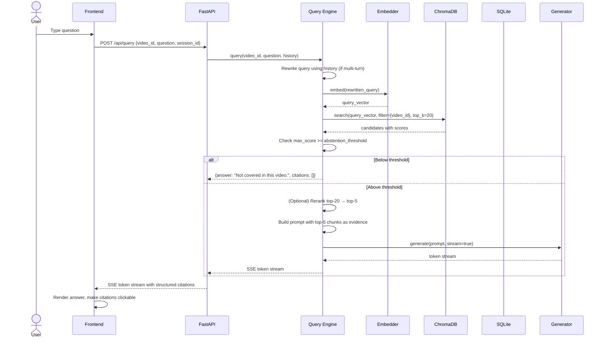
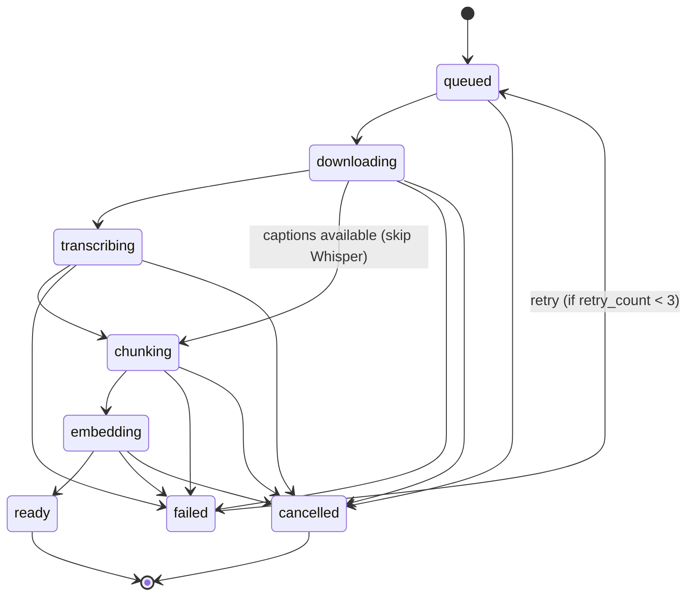
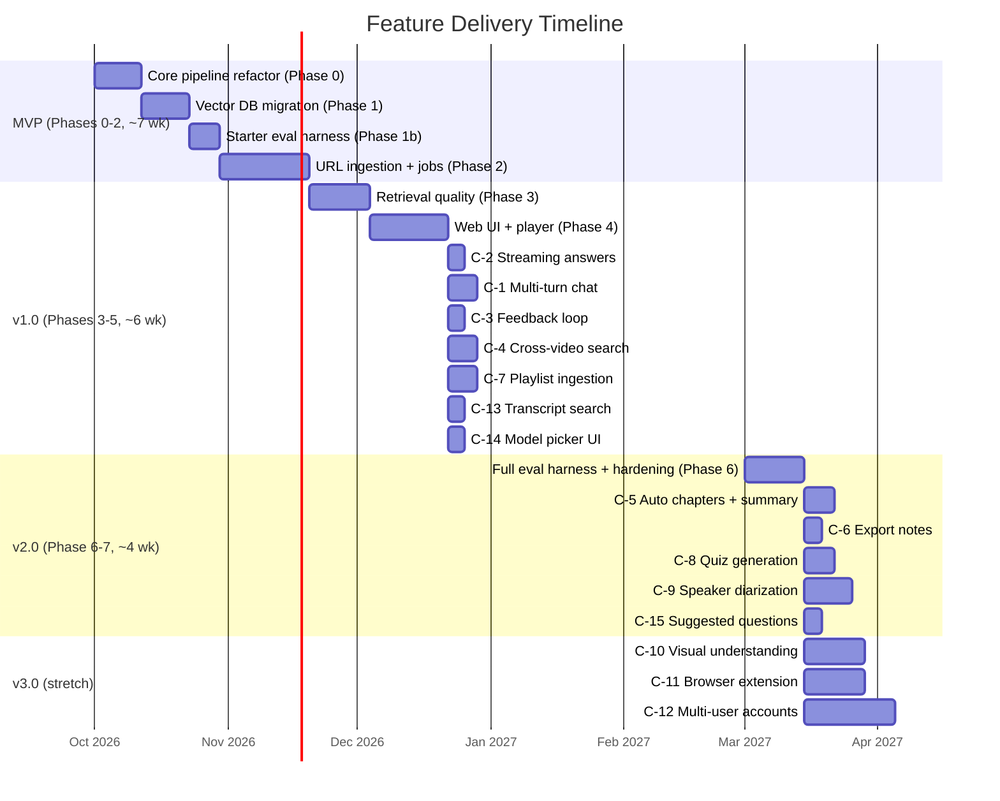

# VideoQA — Product Requirements Document, Implementation Plan & Feature Roadmap

**Product Name:** VideoQA (working title; replaces "RAG-Based AI Teaching Assistant")
**Author:** Staff AI/ML Engineer & Senior PM
**Date:** 2026-10-01
**Status:** Draft v1.0 — ready for team review
**Source project:** [RAG-Based AI Teaching Assistance](file:///d:/RAG-Based%20AI%20Teaching%20Assistance)

---

# DELIVERABLE A — PRODUCT REQUIREMENTS DOCUMENT

---

## A-1. Overview, Vision & Problem Statement

### Vision
Turn any video into a conversation. A user pastes a URL or uploads a file, and within minutes they can ask questions in plain English and get answers grounded in the video's own words, with clickable citations that jump to the exact second.

### Problem
- A typical 20-minute tutorial contains ~3,000 spoken words. Finding one concept means scrubbing through 1,200 seconds of timeline. A significant fraction of a learner's session time is spent seeking, not learning.
- Most YouTube videos lack manually authored chapters, and in-video search is limited to exact caption matches — no semantic understanding.
- Generic chatbots (ChatGPT, Gemini) will answer JavaScript questions, but they fabricate code that may contradict what the instructor actually demonstrated, and they cannot cite "Video 7 at 4:32."
- The existing prototype proves the concept on 15 Hindi-language lectures (3.4 hours) but has no UI, no URL ingestion, no persistent storage, and several architectural gaps documented in sections A-1.1 through A-1.4.

### Report-Inconsistency Resolution

> [!IMPORTANT]
> The user flagged four inconsistencies in the existing project report. These are resolved below and feed directly into the requirements.

| # | Inconsistency | Finding after code inspection | Resolution |
|---|---|---|---|
| **I-1** | Report says retrieval operates over 4,628 vectors but also says chunks were merged to 932. | [`process_json.py`](file:///d:/RAG-Based%20AI%20Teaching%20Assistance/process_json.py) line 20 reads from `jsons/` (4,628 raw Whisper segments). [`merge_chunks.py`](file:///d:/RAG-Based%20AI%20Teaching%20Assistance/merge_chunks.py) writes to `newjsons/` but nothing downstream consumes it. The live index truly has **4,628 rows**. The merge step is dead code in the current pipeline. | Phase 0 will switch `process_json.py` to read from `newjsons/`, making the 932-chunk merged index the production index. |
| **I-2** | Report claims chunks "overlap slightly in speech continuity" but the merge code uses `start_idx = i*n` with no overlap. | Confirmed: [`merge_chunks.py`](file:///d:/RAG-Based%20AI%20Teaching%20Assistance/merge_chunks.py) lines 19-20 show stride = n = 5 with zero overlap. There is no sliding window; it is a non-overlapping partition. | Phase 3 will implement true overlapping windows (stride < window size). The report text is incorrect and must be corrected. |
| **I-3** | Roadmap Gantt marks "Migrate to ChromaDB / FAISS" as `:done` but the limitations table says it is future work. | `embeddings.joblib` is still the only store. No vector DB exists in the repo. | Mark as **not done**. Phase 1 will perform this migration. |
| **I-4** | Out-of-domain guardrail is described as using a similarity-score threshold (< 0.28), but the code has no threshold check — it relies solely on the LLM prompt. | [`process_incoming.py`](file:///d:/RAG-Based%20AI%20Teaching%20Assistance/process_incoming.py) has no score filtering. The 0.28 figure appears only in the report narrative. | Phase 3 will implement an explicit programmatic similarity-score floor. FR-RET-4 below codifies this. |

---

## A-2. Target Users & Personas

| Persona | Description | Jobs-to-Be-Done |
|---|---|---|
| **Riya — Self-Paced Learner** | 21-year-old CS student in India following a Hindi YouTube tutorial series on Node.js. Has spotty internet and limited patience for re-watching entire lectures. | (1) Find where the instructor explains `let` vs `const`. (2) Get the answer in English even though the lecture is in Hindi. (3) Jump to that moment with one click. |
| **Arjun — Course Creator** | Instructor who publishes 30+ hours of video on YouTube. Wants to offer a "search my course" feature on his website so students stop asking repeat questions on Telegram. | (1) Ingest an entire playlist. (2) Embed a chat widget in his site. (3) See which questions students ask most. |
| **Priya — Meeting Reviewer** | Product manager who records team standups and sprint retros. Needs to find who committed to what, and when. | (1) Upload a 45-min meeting recording. (2) Ask "What did Dev say about the API deadline?" (3) Get the answer with a timestamp link. |

---

## A-3. Goals, Non-Goals & Success Metrics

### Goals
| ID | Goal |
|---|---|
| G-1 | Any user can make a single video queryable in under 5 minutes (for a 20-min video). |
| G-2 | Answers cite the exact timestamp range; clicking the citation starts playback at that second. |
| G-3 | The system abstains (says "not covered in this video") rather than hallucinating when the answer is not in the transcript. |
| G-4 | Works fully local on a single machine with a consumer GPU (8 GB VRAM). |
| G-5 | URL ingestion works for YouTube (MVP) and direct file links (v1). |

### Non-Goals (explicit scope exclusions for MVP & v1)
| ID | Non-Goal |
|---|---|
| NG-1 | Real-time / live-stream transcription. |
| NG-2 | Multi-user auth, access control, or SaaS billing. |
| NG-3 | Visual understanding (OCR of slides, keyframe extraction) — deferred to v2. |
| NG-4 | Mobile-native apps. |
| NG-5 | Fine-tuning Whisper or the LLM on user data. |

### Success Metrics

| Metric | Target | Measurement |
|---|---|---|
| **Retrieval Recall@5** | ≥ 0.80 on golden question set | Automated eval harness |
| **Mean Reciprocal Rank (MRR)** | ≥ 0.65 | Automated eval harness |
| **Answer Faithfulness** | ≥ 0.90 (fraction of claims traceable to a retrieved chunk) | LLM-as-judge + human spot-check |
| **Citation Accuracy** | ≥ 0.95 (cited timestamp range contains the relevant content) | Human evaluation on 50 questions |
| **Abstention Precision** | ≥ 0.85 (when system says "not covered", it's truly absent) | Adversarial OOD test set |
| **Ingestion Throughput** | ≤ 4× real-time on consumer GPU for transcription (i.e. 1 hour of video transcribed in ≤ 4 hours with Whisper large-v2, or ≤ 20 min with faster-whisper large-v2) | Benchmark timer |
| **Time-to-First-Answer** | ≤ 8 seconds from query submission (after video is indexed) | P95 latency measurement |
| **User Task Success Rate** | ≥ 0.75 (user finds what they were looking for) | Post-task survey in usability test |

---

## A-4. User Stories & Acceptance Criteria

### US-1: Paste a YouTube URL
**As** Riya, **I want to** paste a YouTube video URL into the app **so that** the video becomes queryable.

| # | Acceptance Criterion |
|---|---|
| AC-1.1 | **Given** the URL `https://www.youtube.com/watch?v=dQw4w9WgXcQ`, **When** I paste it and click "Ingest", **Then** the system extracts the video ID `dQw4w9WgXcQ`, displays the video title, thumbnail, and duration within 3 seconds. |
| AC-1.2 | **Given** the video ID is already in the library, **When** I paste the same URL, **Then** the system shows "Already indexed" and opens the existing chat. |
| AC-1.3 | **Given** the video has existing YouTube captions, **When** ingestion starts, **Then** the system first attempts to fetch those captions; if successful, it skips Whisper transcription. |
| AC-1.4 | **Given** the video is 3 hours long, **When** ingestion starts, **Then** a progress bar shows stages (downloading → transcribing → chunking → embedding → ready) and estimated time remaining. |
| AC-1.5 | **Given** ingestion fails at the transcription stage, **When** the system retries twice, **Then** it marks the job as "failed" with an error message and a "Retry" button. |

### US-2: Ask a Question
**As** Riya, **I want to** type "Where does the teacher explain forEach?" **so that** I get an answer pointing me to the exact video moment.

| # | Acceptance Criterion |
|---|---|
| AC-2.1 | **Given** the video is indexed and contains forEach content at 05:12–06:40, **When** I ask the question, **Then** the answer includes a citation `[05:12–06:40]` that is a clickable link. |
| AC-2.2 | **Given** the embedded player is visible, **When** I click the citation, **Then** the player seeks to 05:12 and begins playback. |
| AC-2.3 | **Given** the question is "What is the capital of France?", **When** I ask it, **Then** the system responds with "This question is not covered in the video." |

### US-3: Upload a Local File
**As** Priya, **I want to** drag and drop an MP4 file of my team meeting **so that** I can search it.

| # | Acceptance Criterion |
|---|---|
| AC-3.1 | **Given** I drop a 200 MB `.mp4` file, **When** upload completes, **Then** ingestion proceeds identically to URL-based ingestion from the audio-extraction stage onward. |
| AC-3.2 | **Given** I drop a `.txt` file, **When** I click ingest, **Then** the system rejects it with "Unsupported file type." |
| AC-3.3 | **Given** I drop a file larger than the configured limit (default 2 GB), **Then** the system rejects it before upload completes. |

### US-4: Multi-Turn Conversation
**As** Riya, **I want to** ask a follow-up question like "Can you explain that in more detail?" **so that** the system understands "that" refers to my previous question.

| # | Acceptance Criterion |
|---|---|
| AC-4.1 | **Given** my previous question was about `forEach`, **When** I say "show me another example of that", **Then** the system rewrites the query internally to something like "another example of forEach" before retrieving. |

### US-5: Video Library
**As** Arjun, **I want to** see all my indexed videos in a library view **so that** I can manage them.

| # | Acceptance Criterion |
|---|---|
| AC-5.1 | **Given** I have 12 indexed videos, **When** I open the library, **Then** I see a card grid with title, thumbnail, duration, indexed-date, and chunk count for each. |
| AC-5.2 | **Given** I click "Delete" on a video, **When** I confirm, **Then** the video, its chunks, and embeddings are permanently removed. |

---

## A-5. Functional Requirements

### Ingestion — File Upload

| ID | Requirement | Priority |
|---|---|---|
| FR-ING-1 | Accept video files via drag-and-drop or file picker. Supported formats: `.mp4`, `.webm`, `.mkv`, `.mov`, `.avi`, `.mp3`, `.wav`, `.m4a`. | P0 |
| FR-ING-2 | Validate file type by MIME type and magic bytes, not just extension. | P1 |
| FR-ING-3 | Enforce a configurable max file size (default 2 GB). | P0 |
| FR-ING-4 | Store uploaded files in a configurable `media/` directory; delete the source file after audio extraction unless user opts to keep. | P1 |

### Ingestion — URL

| ID | Requirement | Priority |
|---|---|---|
| FR-URL-1 | Accept YouTube video URLs in all standard formats: `youtube.com/watch?v=`, `youtu.be/`, `youtube.com/shorts/`, `youtube.com/embed/`. Extract the 11-character video ID. | P0 |
| FR-URL-2 | Accept direct-link URLs to `.mp4`, `.webm`, `.mp3` files (HTTP 200 with `Content-Type: video/*` or `audio/*`). | P1 |
| FR-URL-3 | **Caption-first strategy:** For YouTube, attempt to fetch existing captions via `yt-dlp --write-sub --write-auto-sub --sub-lang en,hi --skip-download`. If usable captions are found (VTT/SRT with timestamps), parse them directly into chunks, skipping Whisper entirely. Log which strategy was used. | P0 |
| FR-URL-4 | **Audio-download fallback:** If no captions exist, download audio-only via `yt-dlp -x --audio-format mp3 --audio-quality 0`. Do not download the video stream. | P0 |
| FR-URL-5 | **Metadata capture:** On URL submission, immediately fetch and store: `video_id`, `title`, `channel`, `duration_seconds`, `thumbnail_url`, `upload_date`, `description` (first 500 chars), `detected_language`. | P0 |
| FR-URL-6 | **Deduplication:** Before starting any download, check if `video_id` (or URL-derived hash for non-YouTube) already exists in the `videos` table. If so, return the existing record with status `already_indexed`. | P0 |
| FR-URL-7 | **Progress states:** Every ingestion job moves through: `queued` → `downloading` → `transcribing` → `chunking` → `embedding` → `ready`. On failure: `failed` with `error_message` and `retry_count`. | P0 |
| FR-URL-8 | **Cancellation:** A user can cancel a job in any state before `ready`. Cancellation cleans up partial files and removes any partial DB entries. | P1 |
| FR-URL-9 | **Duration limit:** Reject videos longer than a configurable max (default 4 hours) at the metadata-fetch stage, before downloading. | P1 |
| FR-URL-10 | **Retry:** On transient failure (network timeout, Ollama 503), retry the failing stage up to 3 times with exponential backoff (1 s, 4 s, 16 s). After 3 failures, mark `failed`. | P0 |

### Ingestion — Long Video Handling

| ID | Requirement | Priority |
|---|---|---|
| FR-LV-1 | For audio files longer than 30 minutes, split the audio into segments of ≤ 30 minutes using FFmpeg's `-ss` and `-t` flags before passing to Whisper, to bound peak memory at ~4 GB. | P0 |
| FR-LV-2 | After transcribing each audio segment, offset all timestamps by the segment's start time. E.g., segment 2 starts at 1800 s: a Whisper timestamp of 45.0 s becomes 1845.0 s in the final transcript. | P0 |
| FR-LV-3 | Stitch segment transcripts into a single ordered transcript JSON before chunking. | P0 |

### Transcription

| ID | Requirement | Priority |
|---|---|---|
| FR-TRX-1 | **Auto-detect language** instead of hardcoding `language="hi"`. Use Whisper's built-in language detection on the first 30 seconds, then pass the detected language code to the full transcription call. | P0 |
| FR-TRX-2 | **Dual transcript:** Run transcription twice when the detected language ≠ English: once with `task="transcribe"` (original language) and once with `task="translate"` (English). Store both. | P1 |
| FR-TRX-3 | Let the user choose which transcript to search against (original or English). Default to English. | P2 |
| FR-TRX-4 | Store the raw Whisper segment JSON (with all timestamps) permanently for reprocessing without re-running Whisper. | P0 |

### Chunking

| ID | Requirement | Priority |
|---|---|---|
| FR-CHK-1 | Default chunking: merge consecutive Whisper segments into chunks of ~150–250 words (adaptive window) instead of a fixed count of 5 segments. | P0 |
| FR-CHK-2 | **Overlap:** Apply a 20 % overlap between adjacent chunks (stride = 0.8 × window). | P1 |
| FR-CHK-3 | **Pause-aware boundaries:** Prefer chunk boundaries at points where the gap between consecutive Whisper segments is ≥ 2.0 seconds (indicating a natural pause or topic shift), when such a boundary falls within the target window range. | P2 |
| FR-CHK-4 | Each chunk record stores: `chunk_id`, `video_id`, `text`, `start_seconds`, `end_seconds`, `word_count`, `language`, `chunk_index`. | P0 |

### Indexing

| ID | Requirement | Priority |
|---|---|---|
| FR-IDX-1 | Store embeddings in a persistent vector database (ChromaDB or equivalent), not in-memory joblib. | P0 |
| FR-IDX-2 | Each embedding is associated with its `chunk_id`. Metadata fields (`video_id`, `title`, `start_seconds`, `end_seconds`, `text`) are stored alongside the vector for filtered retrieval. | P0 |
| FR-IDX-3 | Support scoped retrieval: query within a single video, across a subset (playlist), or across the entire library. | P1 |

### Retrieval

| ID | Requirement | Priority |
|---|---|---|
| FR-RET-1 | Retrieve top-K chunks (default K=5, configurable) by cosine similarity. | P0 |
| FR-RET-2 | **Hybrid search:** Combine dense similarity (bge-m3) with sparse keyword matching (BM25 or full-text search in SQLite FTS5) via Reciprocal Rank Fusion: `RRF_score(d) = Σ 1/(k + rank_dense(d)) + 1/(k + rank_sparse(d))` with k=60. | P1 |
| FR-RET-3 | **Reranking:** After initial retrieval of top-20 candidates, rerank with a multilingual cross-encoder (`BAAI/bge-reranker-v2-m3`, chosen to match the bge-m3 embedder's language coverage) to select the final top-5. | P2 |
| FR-RET-4 | **Abstention & Grounded/Fallback Behavior:** If the highest **similarity** score among the top-K results is at or above the calibrated threshold (default 0.35, to be calibrated in Phase 1b), answer only from retrieved chunks with citations and deep links built in code (never written by LLM). If below the threshold, do NOT stop with a canned refusal. Instead, stream a general answer from the same model using a separate system prompt (concise, general knowledge; never implies video source; no invented citations/timestamps). Governed by config flag `general_fallback.enabled` (default `true`). The `/api/query` SSE contract emits: first a `meta` event (`{grounded: bool}`), then `token` events, then a `done` event (`{grounded, answer_source: "videos" | "general_model", citations, closest_matches, max_similarity_score, timings}`). ChromaDB cosine distances must always be converted via `similarity = 1.0 - distance` before threshold checks. | P0 |
| FR-RET-5 | **Multi-video retrieval:** When query scope is "library", return results grouped by video with per-video relevance ordering. | P1 |

### Answer Generation

| ID | Requirement | Priority |
|---|---|---|
| FR-GEN-1 | Construct a system prompt that includes the retrieved chunks as evidence and instructs the LLM to: (a) answer only from evidence, (b) cite each claim with `[Title @ MM:SS–MM:SS]`, (c) say "not covered" if evidence is insufficient. | P0 |
| FR-GEN-2 | Format timestamps as `MM:SS` for display, but include raw seconds in a machine-readable data attribute for deep linking. | P0 |
| FR-GEN-3 | **Streaming:** Stream LLM tokens to the UI as they are generated (SSE or WebSocket) so the user sees progressive output. | P1 |
| FR-GEN-4 | **Model abstraction:** The generation endpoint accepts a `model` parameter. Default: `llama3.2` via Ollama. Allow override to any Ollama-served model or an OpenAI-compatible API key. | P1 |

### Citations & Player Sync

| ID | Requirement | Priority |
|---|---|---|
| FR-CIT-1 | Each citation in the answer is a clickable hyperlink. For YouTube videos, the link is `https://youtu.be/{video_id}?t={start_seconds}`. For uploaded files, it triggers `player.currentTime = start_seconds` on the embedded HTML5 `<video>` element. | P0 |
| FR-CIT-2 | The UI renders an embedded player (YouTube iframe for YT videos, HTML5 `<video>` for uploads) alongside the chat. | P0 |
| FR-CIT-3 | Clicking a citation scrolls the chat to that citation and highlights it for 2 seconds. | P2 |

### Library Management

| ID | Requirement | Priority |
|---|---|---|
| FR-LIB-1 | List all indexed videos with metadata (title, duration, thumbnail, date indexed, chunk count, status). | P0 |
| FR-LIB-2 | Delete a video: removes video metadata, transcript, chunks, and embeddings. Uploaded media is deleted from disk. | P0 |
| FR-LIB-3 | Re-index a video (re-run chunking and embedding without re-transcribing). | P2 |

### Multi-Turn Chat

| ID | Requirement | Priority |
|---|---|---|
| FR-CHAT-1 | Maintain a per-video chat session with message history (user + assistant turns). | P1 |
| FR-CHAT-2 | On each new user message, use the last 3 turns of history to rewrite the current query before retrieval (query expansion via LLM). | P1 |
| FR-CHAT-3 | "New Chat" button clears history and starts fresh. | P1 |

### Export

| ID | Requirement | Priority |
|---|---|---|
| FR-EXP-1 | Export the full transcript of a video as `.txt`, `.srt`, or `.vtt`. | P2 |
| FR-EXP-2 | Export the chat conversation as Markdown. | P2 |

---

## A-6. Non-Functional Requirements

| ID | Category | Requirement | Target |
|---|---|---|---|
| NFR-1 | **Latency** | Time from query submit to first streamed token | ≤ 3 s (P95) with local Ollama |
| NFR-2 | **Latency** | Full answer delivery | ≤ 12 s (P95) |
| NFR-3 | **Throughput** | Concurrent ingestion jobs | ≥ 2 (sequential Whisper, parallel embedding) |
| NFR-4 | **Accuracy** | Word Error Rate (WER) on English transcription | ≤ 12 % (Whisper large-v2 baseline) |
| NFR-5 | **Cost** | Local mode: zero API cost | $0 / month |
| NFR-6 | **Cost** | Cloud mode (optional): transcription + embedding + LLM | ≤ $0.50 per hour of video ingested |
| NFR-7 | **Privacy** | Local-first: no data leaves the machine unless user explicitly configures a cloud provider | Default mode |
| NFR-8 | **Scalability** | Support ≥ 500 indexed videos (≥ 250 hours) on a single machine | SQLite + ChromaDB can handle this |
| NFR-9 | **Observability** | Structured JSON logs for every pipeline stage with `job_id`, `stage`, `duration_ms`, `status` | All stages |
| NFR-10 | **Accessibility** | Chat UI supports keyboard navigation, screen reader labels, sufficient color contrast (WCAG AA) | v1 |

---

## A-7. System Architecture

### Component Diagram



### Model/Provider Abstraction Layer

Every model call goes through an abstract interface:

```python
# videoqa/models/base.py
class TranscriberBackend(Protocol):
    def transcribe(self, audio_path: str, language: str | None, task: str) -> TranscriptResult: ...

class EmbedderBackend(Protocol):
    def embed(self, texts: list[str]) -> list[list[float]]: ...

class GeneratorBackend(Protocol):
    def generate(self, prompt: str, system: str, stream: bool) -> Iterator[str]: ...
```

Concrete implementations: `OllamaEmbedder`, `OllamaGenerator`, `FasterWhisperTranscriber`, `OpenAIEmbedder`, etc. Configured via `config.yaml` or environment variables.

### Data Flow: URL Ingestion



### Data Flow: Query



---

## A-8. Data Model

### SQLite Tables

```sql
-- Videos table
CREATE TABLE videos (
    id              TEXT PRIMARY KEY,               -- UUID
    video_id        TEXT UNIQUE,                     -- YouTube ID or hash of file
    source_type     TEXT NOT NULL,                   -- 'youtube' | 'direct_url' | 'file_upload'
    source_url      TEXT,
    title           TEXT NOT NULL,
    channel         TEXT,
    duration_seconds REAL NOT NULL,
    thumbnail_url   TEXT,
    upload_date     TEXT,
    description     TEXT,
    detected_language TEXT,                          -- ISO 639-1
    file_path       TEXT,                            -- local path to media (if uploaded)
    status          TEXT NOT NULL DEFAULT 'queued',  -- queued|downloading|transcribing|chunking|embedding|ready|failed
    error_message   TEXT,
    retry_count     INTEGER DEFAULT 0,
    chunk_count     INTEGER DEFAULT 0,
    caption_source  TEXT,                            -- 'youtube_manual'|'youtube_auto'|'whisper'
    created_at      TEXT NOT NULL,
    updated_at      TEXT NOT NULL
);

-- Raw transcript segments (preserved for reprocessing)
CREATE TABLE transcript_segments (
    id              INTEGER PRIMARY KEY AUTOINCREMENT,
    video_id        TEXT NOT NULL REFERENCES videos(video_id),
    segment_index   INTEGER NOT NULL,
    start_seconds   REAL NOT NULL,
    end_seconds     REAL NOT NULL,
    text_original   TEXT,                            -- original language transcript
    text_english    TEXT,                            -- English translation
    language        TEXT,
    UNIQUE(video_id, segment_index)
);

-- Merged chunks (what gets embedded and retrieved)
CREATE TABLE chunks (
    chunk_id        TEXT PRIMARY KEY,                -- UUID
    video_id        TEXT NOT NULL REFERENCES videos(video_id),
    chunk_index     INTEGER NOT NULL,
    start_seconds   REAL NOT NULL,
    end_seconds     REAL NOT NULL,
    text            TEXT NOT NULL,                   -- text used for embedding (English by default)
    text_original   TEXT,                            -- original language text
    word_count      INTEGER NOT NULL,
    language        TEXT,
    UNIQUE(video_id, chunk_index)
);
-- FTS5 virtual table for BM25 keyword search
CREATE VIRTUAL TABLE chunks_fts USING fts5(
    chunk_id, text, content='chunks', content_rowid='rowid'
);

-- Ingestion jobs
CREATE TABLE jobs (
    job_id          TEXT PRIMARY KEY,
    video_id        TEXT NOT NULL REFERENCES videos(video_id),
    status          TEXT NOT NULL,
    stage           TEXT,
    progress_pct    REAL DEFAULT 0,
    started_at      TEXT,
    completed_at    TEXT,
    error_message   TEXT,
    created_at      TEXT NOT NULL
);

-- Chat sessions
CREATE TABLE chat_sessions (
    session_id      TEXT PRIMARY KEY,
    video_id        TEXT,                            -- NULL for cross-library queries
    created_at      TEXT NOT NULL,
    updated_at      TEXT NOT NULL
);

CREATE TABLE chat_messages (
    id              INTEGER PRIMARY KEY AUTOINCREMENT,
    session_id      TEXT NOT NULL REFERENCES chat_sessions(session_id),
    role            TEXT NOT NULL,                   -- 'user' | 'assistant'
    content         TEXT NOT NULL,
    citations       TEXT,                            -- JSON array of {chunk_id, start, end, text_snippet}
    created_at      TEXT NOT NULL
);

-- User feedback on answers
CREATE TABLE feedback (
    id              INTEGER PRIMARY KEY AUTOINCREMENT,
    message_id      INTEGER NOT NULL REFERENCES chat_messages(id),
    rating          INTEGER,                         -- 1 (thumbs down) or 5 (thumbs up)
    comment         TEXT,
    created_at      TEXT NOT NULL
);
```

### ChromaDB Collection Schema

```
Collection: "videoqa_chunks"
  id:        chunk_id (string)
  embedding: float[1024]
  metadata:
    video_id:        string
    title:           string
    start_seconds:   float
    end_seconds:     float
    text:            string (first 500 chars for Chroma metadata limit)
    chunk_index:     int
    language:        string
```

### Chunk Metadata Schema (JSON)

```json
{
  "chunk_id": "a3f2b1c4-...",
  "video_id": "dQw4w9WgXcQ",
  "chunk_index": 14,
  "start_seconds": 312.5,
  "end_seconds": 347.8,
  "text": "Now let's look at the forEach loop. forEach is a method available on arrays...",
  "text_original": "अब देखते हैं forEach loop को...",
  "word_count": 42,
  "language": "hi",
  "title": "iterators for in for of and for each",
  "video_title": "13-iterators for in for of and for each"
}
```

---

## A-9. API Specification

Base URL: `http://localhost:8000/api`

### POST /api/ingest/url — Ingest a video from URL

**Request:**
```json
{
  "url": "https://www.youtube.com/watch?v=dQw4w9WgXcQ",
  "language_hint": "auto",
  "search_language": "english"
}
```

**Response (202 Accepted):**
```json
{
  "job_id": "job_7f3a9b2c",
  "video_id": "dQw4w9WgXcQ",
  "title": "Never Gonna Give You Up",
  "duration_seconds": 212,
  "thumbnail_url": "https://i.ytimg.com/vi/dQw4w9WgXcQ/maxresdefault.jpg",
  "status": "queued",
  "estimated_time_seconds": 180
}
```

**Response (200 — already indexed):**
```json
{
  "video_id": "dQw4w9WgXcQ",
  "status": "already_indexed",
  "message": "This video is already in your library."
}
```

**Error (422):**
```json
{
  "error": "validation_error",
  "message": "Video duration (5h 12m) exceeds maximum of 4 hours."
}
```

### POST /api/ingest/file — Upload and ingest a local file

**Request:** `multipart/form-data` with field `file` (binary).

**Response:** Same 202 shape as URL ingestion.

### GET /api/jobs/{job_id} — Job status

**Response:**
```json
{
  "job_id": "job_7f3a9b2c",
  "video_id": "dQw4w9WgXcQ",
  "status": "transcribing",
  "stage": "whisper",
  "progress_pct": 45.2,
  "started_at": "2026-10-01T12:00:00Z",
  "elapsed_seconds": 120
}
```

### GET /api/videos — List all indexed videos

**Response:**
```json
{
  "videos": [
    {
      "video_id": "dQw4w9WgXcQ",
      "title": "Never Gonna Give You Up",
      "duration_seconds": 212,
      "thumbnail_url": "...",
      "chunk_count": 18,
      "status": "ready",
      "created_at": "2026-10-01T12:05:00Z"
    }
  ],
  "total": 1
}
```

### POST /api/query — Ask a question

**Request:**
```json
{
  "video_id": "dQw4w9WgXcQ",
  "question": "Where does the teacher explain forEach?",
  "session_id": "sess_abc123",
  "top_k": 5,
  "scope": "single_video"
}
```

**Response (200, streamed via SSE):**

*Case 1: Grounded answer (max_similarity >= threshold)*
```
event: meta
data: {"grounded": true}

event: token
data: {"text": "The "}

event: token
data: {"text": "forEach "}

...

event: done
data: {
  "grounded": true,
  "answer_source": "videos",
  "citations": [
    {
      "chunk_id": "a3f2b1c4-...",
      "video_id": "dQw4w9WgXcQ",
      "title": "iterators for in for of and for each",
      "start_seconds": 312,
      "end_seconds": 400,
      "start_display": "05:12",
      "end_display": "06:40",
      "deeplink": "https://youtu.be/dQw4w9WgXcQ?t=312",
      "text_snippet": "Now let's look at the forEach loop..."
    }
  ],
  "closest_matches": [],
  "max_similarity_score": 0.84,
  "timings": {
    "retrieval_ms": 45,
    "generation_ms": 2100
  }
}
```

*Case 2: Fallback answer (max_similarity < threshold, general_fallback.enabled = true)*
```
event: meta
data: {"grounded": false}

event: token
data: {"text": "The "}

event: token
data: {"text": "capital "}

...

event: done
data: {
  "grounded": false,
  "answer_source": "general_model",
  "citations": [],
  "closest_matches": [
    {
      "video_id": "dQw4w9WgXcQ",
      "title": "how to install nodejs",
      "start_seconds": 120,
      "start_display": "02:00",
      "similarity": 0.18
    }
  ],
  "max_similarity_score": 0.18,
  "timings": {
    "retrieval_ms": 42,
    "generation_ms": 1850
  }
}
```

### DELETE /api/videos/{video_id} — Remove a video

**Response (200):**
```json
{
  "deleted": true,
  "video_id": "dQw4w9WgXcQ",
  "chunks_removed": 18
}
```

### POST /api/chat — Multi-turn chat (alternative to /query with session awareness)

**Request:**
```json
{
  "session_id": "sess_abc123",
  "message": "Can you explain that in more detail?"
}
```

**Response:** Same SSE structure as /api/query.

---

## A-10. UX — Key Screens & Flows

### Screen 1: Landing / Ingest Page

```
┌──────────────────────────────────────────────────────────────┐
│  VideoQA — Ask Your Videos Anything                          │
│                                                              │
│  ┌────────────────────────────────────────────────────────┐  │
│  │  Paste a YouTube URL or drop a video file here         │  │
│  │                                                        │  │
│  │  [ https://youtube.com/watch?v=...          ] [Ingest] │  │
│  │                                                        │  │
│  │     ─── or ───                                         │  │
│  │                                                        │  │
│  │  ┌──────────────────────────────────────────┐          │  │
│  │  │   📂  Drop .mp4, .webm, .mp3 here       │          │  │
│  │  │       (max 2 GB)                         │          │  │
│  │  └──────────────────────────────────────────┘          │  │
│  └────────────────────────────────────────────────────────┘  │
│                                                              │
│  Your Library (3 videos)                                     │
│  ┌────────┐  ┌────────┐  ┌────────┐                         │
│  │ 🎬     │  │ 🎬     │  │ 🎬     │                         │
│  │ Title 1│  │ Title 2│  │ Title 3│                         │
│  │ 10:23  │  │ 45:11  │  │ 22:07  │                         │
│  │[Chat]  │  │[Chat]  │  │[Chat]  │                         │
│  └────────┘  └────────┘  └────────┘                         │
└──────────────────────────────────────────────────────────────┘
```

### Screen 2: Ingestion Progress

```
┌──────────────────────────────────────────────────────────────┐
│  Processing: "13-iterators for in for of and for each"       │
│                                                              │
│  ✅ Downloading          [████████████████████] 100%          │
│  ✅ Transcribing         [████████████████████] 100%          │
│  🔄 Chunking             [████████░░░░░░░░░░░░]  42%          │
│  ⏳ Embedding             [░░░░░░░░░░░░░░░░░░░░]   0%          │
│                                                              │
│  Estimated: 2 min remaining                                  │
│                                     [Cancel]                 │
└──────────────────────────────────────────────────────────────┘
```

### Screen 3: Chat + Player (main interaction screen)

```
┌──────────────────────────────────────────────────────────────┐
│  ← Library    "13-iterators for in for of and for each"      │
├─────────────────────────────┬────────────────────────────────┤
│                             │                                │
│   ┌───────────────────────┐ │  💬 Chat                       │
│   │                       │ │                                │
│   │    ▶  Video Player    │ │  You: Where is forEach         │
│   │    (YouTube iframe    │ │  explained?                    │
│   │     or HTML5 <video>) │ │                                │
│   │                       │ │  Bot: forEach is covered in    │
│   │    advancement 05:12  │ │  detail starting at            │
│   │                       │ │  [05:12–06:40]. The instructor │
│   └───────────────────────┘ │  first shows the syntax, then  │
│                             │  demonstrates iterating over   │
│   Transcript (collapsible)  │  an array of names...          │
│   00:00 Hello friends...    │                                │
│   00:15 Today we will...    │  ┌────────────────────────────┐│
│   ...                       │  │  Ask a question...    [⏎]  ││
│                             │  └────────────────────────────┘│
├─────────────────────────────┴────────────────────────────────┤
│  Powered by Whisper + bge-m3 + Llama 3.2 • Running locally   │
└──────────────────────────────────────────────────────────────┘
```

---

## A-11. Retrieval & Answer Quality Design

### Chunking Strategy

| Property | Current (broken) | Proposed |
|---|---|---|
| Unit | Fixed 5 Whisper segments | Adaptive: 150–250 words |
| Overlap | None (inconsistency I-2 confirmed) | 20 % stride overlap |
| Boundary | Arbitrary segment count | Prefer natural pauses (≥ 2 s gap) within window range |
| Metadata | number, title, start, end, text | + video_id, chunk_id, chunk_index, word_count, language |

### Hybrid Search

```
          User Question
               │
     ┌─────────┴──────────┐
     ▼                    ▼
  bge-m3 Dense        BM25 Sparse
  (ChromaDB)          (SQLite FTS5)
     │ top-20             │ top-20
     └─────────┬──────────┘
               ▼
       Reciprocal Rank Fusion
       (k=60, combined score)
               │ top-20
               ▼
       Cross-Encoder Rerank (optional, P2)
       BAAI/bge-reranker-v2-m3 (multilingual)
               │ top-5
               ▼
       Abstention Check (max similarity < threshold?)
       (threshold is a configurable placeholder, calibrate with golden set)
               │
     ┌─────────┴──────────┐
     ▼                    ▼
   Yes: canned         No: build prompt
   "not covered"       → LLM generation
```

### Citation Verification

After the LLM generates an answer, a post-processing step:
1. Extracts all `[Title @ MM:SS–MM:SS]` citations via regex.
2. Looks up each cited chunk_id.
3. Verifies the cited timestamp range overlaps with the retrieved chunk's actual `start_seconds`–`end_seconds` (± 10 s tolerance).
4. Strips any citation that fails verification, appending a note: "(citation adjusted)".

### Multi-Video Queries

When scope = `library`:
- Retrieve top-5 from each video, then globally rerank the union.
- Group results by video in the answer: "In Video 3 at [05:12]... In Video 14 at [01:30]..."

---

## A-12. Evaluation Plan

### Golden Question Set

Build a manually curated set of 10 questions per video (150 total for the 15-lecture corpus):
- 5 factual retrieval questions (e.g., "Where is `splice` explained?")
- 3 conceptual questions (e.g., "What is the difference between `==` and `===`?")
- 2 out-of-domain questions (e.g., "How do I cook biryani?")

Each question has:
- Expected relevant chunk IDs (ground truth).
- Expected answer keywords.
- Expected citation timestamp ranges.

### Metrics

| Metric | Definition | Target | Measurement |
|---|---|---|---|
| Recall@5 | Fraction of relevant chunks in top-5 | ≥ 0.80 | Automated |
| Recall@10 | Fraction of relevant chunks in top-10 | ≥ 0.90 | Automated |
| MRR | 1 / rank of first relevant result | ≥ 0.65 | Automated |
| Faithfulness | Claims in answer traceable to a retrieved chunk | ≥ 0.90 | LLM-as-judge (GPT-4o or Claude) |
| Citation Accuracy | Cited timestamp contains relevant content | ≥ 0.95 | Human eval on 50 Qs |
| Abstention Recall | OOD questions correctly abstained | ≥ 0.90 | Automated on OOD set |
| Abstention Precision | Abstentions that are truly OOD | ≥ 0.85 | Human eval |
| WER | Transcript vs manual reference | ≤ 12 % | asr-eval script |

### Regression Testing

When models change (new Whisper version, new embedder, new LLM):
1. Re-run the eval harness on the golden set.
2. Compare metrics to the baseline stored in `eval/baselines/{model_version}.json`.
3. Flag any metric that drops > 5 percentage points.

---

## A-13. Risks & Mitigations

| # | Risk | Impact | Likelihood | Mitigation |
|---|---|---|---|---|
| R-1 | **YouTube ToS:** yt-dlp downloading may violate YouTube Terms of Service for some use cases. | Legal / takedown | Medium | Caption-first strategy (FR-URL-3) avoids downloading when possible. Display a disclaimer: "You are responsible for complying with the platform's Terms of Service. This tool is intended for use with content you own or have permission to process." No media redistribution. |
| R-2 | **Copyright:** User indexes a copyrighted lecture they don't own. | Legal | Medium | Add a checkbox: "I confirm I have the right to process this content." Store no media after audio extraction (delete source). Retention policy: auto-delete media files after 30 days; transcripts and embeddings persist. |
| R-3 | **Privacy:** Meeting recordings may contain PII. | Data breach | Medium | Local-first default (no cloud calls). If cloud mode is configured, warn the user. No telemetry without opt-in. |
| R-4 | **Whisper hallucination on silence/music.** Whisper is known to generate phantom text during long silences or background music. | Bad retrieval | High | Detect low-confidence segments (avg log-probability < -1.0) and mark them `low_confidence=true`. Exclude from embedding. |
| R-5 | **VRAM OOM on Whisper large-v2.** Users with < 8 GB VRAM will fail. | Crash | Medium | Default to `faster-whisper` with `compute_type=int8` (fits in 4 GB). Fallback to `base` model with a quality warning. Config flag: `whisper_model_size`. |
| R-6 | **Ollama not running.** User forgets to start Ollama. | Startup crash | High | Health check on app start: `GET http://localhost:11434/`. Clear error message: "Ollama is not running. Please start it with `ollama serve`." |
| R-7 | **yt-dlp breaking changes.** YouTube frequently changes its API; yt-dlp updates often. | Download fails | High | Pin yt-dlp version. Log download failures distinctly. `pip install --upgrade yt-dlp` in retry path. |
| R-8 | **Embedding model dimension mismatch.** Switching from bge-m3 (1024-dim) to another model breaks existing ChromaDB collection. | Data corruption | Low | Store `embedding_model` and `embedding_dim` in the `videos` table. On model change, require re-indexing. |
| R-9 | **Slow ingestion UX.** CPU-only transcription with openai-whisper large-v2 may take 2–4 hours per hour of video (estimate, to be benchmarked). Even with faster-whisper on GPU, expect ~8 min per video-hour (estimate). | User abandonment | High | Show clear time estimates. Recommend GPU. Offer `faster-whisper` as default (4–8× faster than openai-whisper). Allow background processing with notification when done. |
| R-10 | **LLM prompt injection via transcript.** A malicious video could contain spoken text that tricks the LLM. | Wrong answers | Low | Sanitize chunk text (strip control characters). Use system prompt separation. Consider output validation. |

---

### MVP — Phases 0–2 (backend + API, no polished UI)

Phases 0–2 total ~32.5 engineer-days. For a single engineer, that is roughly **7–8 weeks** including buffer. For two engineers, ~5 weeks.

| Scope IN | Scope OUT |
|---|---|
| YouTube URL ingestion with caption-first | Direct file upload |
| Single-video chat via API / Streamlit demo UI | Polished Next.js web UI |
| Dense retrieval (ChromaDB) | Hybrid search, reranking |
| Abstention threshold (placeholder, to be calibrated) | Multi-turn with query rewriting |
| Auto language detection | Dual transcript (original + English) |
| Job progress via polling | WebSocket push |
| SQLite metadata | Export, feedback loop |
| Starter eval set (~30 questions) with Recall@K, MRR, abstention metrics | Full 150-question eval, LLM-as-judge, CI gating |

### v1.0 — +Phases 3–5 (+~30 engineer-days; ~6 weeks for one engineer)

| Added |
|---|
| Polished Next.js web UI with embedded player + citation deep linking |
| File upload ingestion |
| Hybrid search (BM25 + dense) |
| Multi-turn chat with query rewriting |
| Multi-video library with cross-video search |
| Overlapping + adaptive chunking |
| Streaming answers (SSE) |
| Feedback (thumbs up/down) |
| Playlist ingestion |

### v2.0 — +Phase 6–7 (+~17 engineer-days; ~4 weeks for one engineer)

| Added |
|---|
| Cross-encoder reranking (`BAAI/bge-reranker-v2-m3`) |
| Full 150-question eval harness + LLM-as-judge + CI gating |
| Auto-generated chapters & summary |
| Dual transcript storage (original + English) |
| Export transcript (SRT/VTT) and chat (Markdown) |
| Dockerized deployment |
| Cloud mode (OpenAI API fallback) |
| Direct URL ingestion (non-YouTube .mp4/.mp3 links) |

**Total across all phases (0–6): ~70 engineer-days.** Stretch features (Phase 7) are additive.

---

## A-15. Assumptions & Open Questions

### Assumptions

| # | Assumption |
|---|---|
| A-1 | The user has Ollama installed and running with `bge-m3` and `llama3.2` models pulled. |
| A-2 | `yt-dlp` and `ffmpeg` are installed and on PATH. |
| A-3 | For local mode, the user has a CUDA-capable GPU with ≥ 6 GB VRAM (for faster-whisper int8) or is willing to wait for CPU transcription. |
| A-4 | The product is single-user (no auth) for MVP and v1. |
| A-5 | ChromaDB is used in embedded (in-process) mode with persistent storage on disk, not client-server. |
| A-6 | The existing 15-lecture dataset will be migrated into the new system as the first test corpus. |
| A-7 | SQLite is sufficient for metadata at the expected scale (≤ 500 videos, ≤ 50K chunks). |
| A-8 | `faster-whisper` (CTranslate2 backend) is preferred over `openai-whisper` for 4-8× speedup. Existing Whisper segments remain valid. |

### Open Questions

| # | Question | Suggested Resolution |
|---|---|---|
| OQ-1 | Should we support age-restricted or private YouTube videos? | No for MVP. They require authentication cookies which adds complexity and ToS risk. |
| OQ-2 | Should the UI be a standalone web app or an embeddable widget? | Standalone for MVP. Widget mode is a v2+ feature for Arjun's use case. |
| OQ-3 | Should we store downloaded audio permanently or delete after transcription? | Delete after transcription by default. Config flag `retain_media=false`. |
| OQ-4 | What is the maximum number of concurrent ingestion jobs? | 1 Whisper job at a time (GPU-bound), up to 3 jobs in download/embedding stages. |
| OQ-5 | Should we support non-Latin search queries (e.g., searching in Hindi)? | Yes, bge-m3 is multilingual. If dual transcripts are stored, allow searching against either. v1 feature. |

---

# DELIVERABLE B — IMPLEMENTATION PLAN

---

## B-1. Recommended Tech Stack

### Trade-Off Tables

**Vector Store**

| Option | Pros | Cons | Verdict |
|---|---|---|---|
| **ChromaDB (embedded)** | Zero-config, pip install, persistent, supports metadata filtering, good Python API | Single-process, no built-in BM25 | **✅ Selected for MVP.** Simple. BM25 via SQLite FTS5. |
| FAISS | Blazing fast, battle-tested | No built-in persistence, no metadata filtering, C++ complexity | Overkill for ≤ 50K vectors. |
| Qdrant | Full-featured, client-server, hybrid search | Requires separate process, heavier | Consider if scaling beyond 500 videos. |
| Current (joblib/pandas) | Works today | No persistence, no filtering, full in-memory load, no concurrent access | **❌ Replace.** |

**Transcription Engine**

| Option | Pros | Cons | Verdict |
|---|---|---|---|
| **faster-whisper** (CTranslate2) | 4-8× faster than openai-whisper, int8 quantization (4 GB VRAM for large-v2), same accuracy, Python API | Different import path, no `word_timestamps` in oldest versions (fixed in recent releases) | **✅ Selected.** Major UX win from speed. |
| openai-whisper (current) | Already proven in codebase | Slow (~4× real-time on GPU), high VRAM (≥ 10 GB for large-v2 fp16), PyTorch dependency bloat | Replace, but keep as fallback config. |
| OpenAI Whisper API (cloud) | Fastest, no GPU needed, $0.006/min | Privacy concern, cost at scale, requires internet | Optional cloud backend via provider abstraction. |

**Backend Framework**

| Option | Pros | Cons | Verdict |
|---|---|---|---|
| **FastAPI** | Async, automatic OpenAPI docs, SSE support, widely adopted | Learning curve for async patterns | **✅ Selected.** |
| Flask | Simple, well-known | Synchronous by default, no async SSE without extensions | Outgrown for this use case. |
| Django | Batteries-included | Too heavy for an API + worker service | Overkill. |

**Job Queue**

| Option | Pros | Cons | Verdict |
|---|---|---|---|
| **asyncio + in-process background tasks** | Zero extra infrastructure, FastAPI `BackgroundTasks` or `asyncio.create_task` | Single-process, no persistence across restarts | **✅ Selected for MVP.** Simplest. |
| Celery + Redis | Production-grade, persistent, retries, monitoring | Requires Redis, complex setup | Consider for v2 if concurrency needs grow. |
| ARQ (async Redis queue) | Lighter than Celery, async-native | Still requires Redis | Good middle ground for v1. |

**Frontend**

| Option | Pros | Cons | Verdict |
|---|---|---|---|
| **Next.js (React)** | SSR, great ecosystem, component model, easy SSE/WebSocket | Requires Node.js, heavier build | **✅ Selected for v1 polished UI.** Best for the player + chat layout. |
| Streamlit | Ultra-fast to prototype, `st.video` accepts YouTube URLs with `&start=N` for initial seek | Cannot programmatically re-seek the player after render (clicking a citation would require a page rerun that reloads the component); limited layout control; not production-grade | **Viable for fast internal MVP/demo UI only.** Use for Phase 2 demo checkpoint; replace with Next.js in Phase 4. |
| Plain HTML + JS | Zero build | Hard to maintain complex UI state | Not for a product. |

**Storage**

| Option | Pros | Cons | Verdict |
|---|---|---|---|
| **SQLite** | Zero-config, file-based, FTS5 for BM25, perfect for single-user local app | No concurrent writes (WAL mode helps) | **✅ Selected.** |
| PostgreSQL | Full ACID, concurrent | Requires separate service | Overkill for local-first. |

### Summary Stack

| Layer | Technology |
|---|---|
| Language | Python 3.11+ |
| Backend | FastAPI |
| Job Queue | asyncio background tasks (MVP) → ARQ + Redis (v2) |
| Transcription | faster-whisper (local) / OpenAI Whisper API (cloud) |
| Embeddings | Ollama bge-m3 (local) / OpenAI text-embedding-3-small (cloud) |
| LLM | Ollama Llama 3.2 (local) / OpenAI GPT-4o-mini (cloud) |
| Vector Store | ChromaDB (embedded, persistent) |
| Metadata DB | SQLite (with FTS5 for BM25) |
| Media Tools | yt-dlp, FFmpeg |
| Frontend |  React Js |
| Deployment | Docker Compose |

---

## B-2. Repository & Module Structure

```
videoqa/
├── README.md
├── pyproject.toml                    # Python package config (pip install -e .)
├── docker-compose.yml
├── Dockerfile
├── config.yaml                       # Default configuration
├── .env.example
│
├── videoqa/                          # Python package
│   ├── __init__.py
│   ├── config.py                     # Load config.yaml + env vars
│   ├── main.py                       # FastAPI app entry point
│   │
│   ├── api/                          # API routes
│   │   ├── __init__.py
│   │   ├── ingest.py                 # POST /api/ingest/url, /api/ingest/file
│   │   ├── videos.py                 # GET /api/videos, DELETE /api/videos/{id}
│   │   ├── query.py                  # POST /api/query, POST /api/chat
│   │   └── jobs.py                   # GET /api/jobs/{id}
│   │
│   ├── core/                         # Business logic
│   │   ├── __init__.py
│   │   ├── ingestion.py              # Orchestrates the full pipeline
│   │   ├── downloader.py             # yt-dlp wrapper, URL validation, caption fetch
│   │   ├── audio.py                  # FFmpeg audio extraction, splitting
│   │   ├── transcriber.py            # Whisper wrapper (transcribe + translate)
│   │   ├── chunker.py                # Adaptive chunking with overlap
│   │   ├── indexer.py                # Embedding + ChromaDB upsert
│   │   ├── retriever.py              # Dense + BM25 hybrid retrieval, reranking
│   │   ├── generator.py              # LLM prompt construction, citation formatting
│   │   └── query_rewriter.py         # Multi-turn query expansion
│   │
│   ├── models/                       # Provider abstraction
│   │   ├── __init__.py
│   │   ├── base.py                   # Protocol definitions (Transcriber, Embedder, Generator)
│   │   ├── ollama_embedder.py
│   │   ├── ollama_generator.py
│   │   ├── faster_whisper_transcriber.py
│   │   ├── openai_embedder.py        # Optional cloud
│   │   ├── openai_generator.py       # Optional cloud
│   │   └── openai_transcriber.py     # Optional cloud
│   │
│   ├── db/                           # Database layer
│   │   ├── __init__.py
│   │   ├── sqlite.py                 # SQLite connection, migrations
│   │   ├── models.py                 # Pydantic models / dataclasses
│   │   └── migrations/               # SQL migration scripts
│   │       ├── 001_initial.sql
│   │       └── ...
│   │
│   ├── vectorstore/                  # Vector DB abstraction
│   │   ├── __init__.py
│   │   ├── base.py                   # VectorStore protocol
│   │   └── chroma.py                 # ChromaDB implementation
│   │
│   └── utils/                        # Shared utilities
│       ├── __init__.py
│       ├── url_parser.py             # URL validation, video ID extraction
│       ├── timestamp.py              # seconds ↔ MM:SS conversion
│       └── logging.py                # Structured JSON logger
│
├── frontend/                         # Next.js app
│   ├── package.json
│   ├── next.config.js
│   ├── src/
│   │   ├── app/
│   │   │   ├── page.tsx              # Landing / ingest page
│   │   │   ├── video/[id]/page.tsx   # Chat + player page
│   │   │   └── library/page.tsx      # Video library
│   │   ├── components/
│   │   │   ├── IngestPanel.tsx
│   │   │   ├── ProgressBar.tsx
│   │   │   ├── ChatWindow.tsx
│   │   │   ├── VideoPlayer.tsx
│   │   │   ├── CitationLink.tsx
│   │   │   ├── VideoCard.tsx
│   │   │   └── TranscriptView.tsx
│   │   └── lib/
│   │       ├── api.ts                # API client
│   │       └── sse.ts                # SSE consumer
│   └── public/
│
├── eval/                             # Evaluation harness
│   ├── golden_questions/
│   │   ├── video_01.json
│   │   └── ...
│   ├── run_eval.py
│   ├── metrics.py
│   └── baselines/
│       └── v0_baseline.json
│
├── scripts/                          # Migration & utility scripts
│   ├── migrate_from_joblib.py        # One-time: joblib → ChromaDB + SQLite
│   └── seed_test_data.py
│
├── tests/
│   ├── unit/
│   │   ├── test_url_parser.py
│   │   ├── test_chunker.py
│   │   ├── test_retriever.py
│   │   └── ...
│   ├── integration/
│   │   ├── test_ingestion_pipeline.py
│   │   ├── test_query_flow.py
│   │   └── ...
│   └── e2e/
│       └── test_full_flow.py
│
└── data/                             # Runtime data (gitignored)
    ├── db/
    │   └── videoqa.db                # SQLite database
    ├── chroma/                       # ChromaDB persistent storage
    ├── media/                        # Uploaded/downloaded media (temp)
    └── transcripts/                  # Raw Whisper JSON outputs
```

---

## B-3. Phased Roadmap

### Phase 0: Refactor & Fix Inconsistencies
**Goal:** Transform the collection of scripts into an installable Python package with a clean library API. Fix the four report inconsistencies.

| Task | Est. (days) | Depends On | Definition of Done |
|---|---|---|---|
| 0.1 Create `pyproject.toml`, package structure under `videoqa/` | 0.5 | — | `pip install -e .` works | DONE 2026-10-04 (commit d409dd4) |
| 0.2 Move `video_to_mp3.py` logic into `videoqa/core/audio.py` | 0.5 | 0.1 | `from videoqa.core.audio import extract_audio` works | DONE 2026-10-04 (commit d409dd4) |
| 0.3 Move `create_chunks.py` / `mp3_to_json.py` into `videoqa/core/transcriber.py` | 1 | 0.1 | Transcription callable as a function | DONE 2026-10-04 (commit d409dd4) |
| 0.4 Move `merge_chunks.py` into `videoqa/core/chunker.py` | 0.5 | 0.1 | Chunker callable as a function | DONE 2026-10-04 (commit d409dd4) |
| 0.5 Move `process_json.py` into `videoqa/core/indexer.py` | 0.5 | 0.1 | Indexer callable as a function | DONE 2026-10-04 (commit d409dd4) |
| 0.6 Move `process_incoming.py` into `videoqa/core/retriever.py` + `generator.py` | 1 | 0.1 | Query callable as a function | DONE 2026-10-04 (commit d409dd4) |
| 0.7 **Fix I-1:** Change indexer to read from merged chunks (`newjsons/`), not raw segments (`jsons/`). Verify index has 932 rows. | 0.5 | 0.4, 0.5 | `embeddings.joblib` rebuilt with 932 rows | DONE 2026-10-04 (commit d409dd4) |
| 0.8 **Fix I-2:** Remove claim of overlap from report/comments. Add TODO for real overlap in Phase 3. | 0.25 | — | Report updated | DONE 2026-10-04 (commit d409dd4) |
| 0.9 **Fix I-3:** Remove `:done` from Gantt chart; mark migration as Phase 1 work. | 0.25 | — | Report updated | DONE 2026-10-04 (commit d409dd4) |
| 0.10 **Fix I-4:** Add similarity-score check in retriever. Read threshold from config. If `max_score < threshold`, return abstention. | 0.5 | 0.6 | Automated test passes with OOD query | DONE 2026-10-04 (commit d409dd4) |
| 0.11 Write unit tests for url_parser, chunker, retriever | 1 | 0.2–0.6 | ≥ 80 % coverage on core modules | DONE 2026-10-04 (commit d409dd4) |
| 0.12 Create `config.yaml` with all configurable parameters | 0.5 | — | Config loaded at startup | DONE 2026-10-04 (commit d409dd4) |

**Total: ~7 engineer-days**
**Demo checkpoint:** Run `python -m videoqa.core.ingestion --video videos/sample.webm` end-to-end from the CLI. Run `python -m videoqa.core.retriever "What is forEach?"` and get a grounded answer.

---

### Phase 1: Vector DB Migration + Persistent Store
**Goal:** Replace joblib with ChromaDB and SQLite for durable, filterable storage.

| Task | Est. (days) | Depends On | Definition of Done |
|---|---|---|---|
| 1.1 Set up SQLite schema (`db/migrations/001_initial.sql`) | 1 | Phase 0 | Tables created; migration script runs idempotently | DONE 2026-10-04 (commit d409dd4) |
| 1.2 Implement `videoqa/db/sqlite.py` (CRUD for videos, chunks, sessions) | 2 | 1.1 | All CRUD operations tested | DONE 2026-10-04 (commit d409dd4) |
| 1.3 Implement `videoqa/vectorstore/chroma.py` (upsert, search, delete) | 1 | Phase 0 | Search returns correct top-K | DONE 2026-10-04 (commit d409dd4) |
| 1.4 Write migration script `scripts/migrate_from_joblib.py` to port the existing 15-lecture index into ChromaDB + SQLite | 1 | 1.2, 1.3 | All 932 chunks in ChromaDB; metadata in SQLite; queries return same results as before | DONE 2026-10-04 (commit d409dd4) |
| 1.5 Update retriever to use ChromaDB instead of cosine_similarity | 0.5 | 1.3 | Retriever integration test passes | DONE 2026-10-04 (commit d409dd4) |
| 1.6 Add FTS5 virtual table for BM25; implement sparse search | 1 | 1.2 | BM25 search returns results for exact keyword queries | DONE 2026-10-04 (commit d409dd4) |
| 1.7 Integration tests | 1 | 1.1–1.6 | Ingest → query → answer pipeline passes end-to-end with persistent storage | DONE 2026-10-04 (commit d409dd4) |

**Total: ~7.5 engineer-days**
**Demo checkpoint:** Ingest a video, restart the process, query it — data survives restart.

---

### Phase 1b: Starter Evaluation Harness
**Goal:** Establish a measurable retrieval quality baseline before making quality changes in Phase 3. Without this, Phase 3 improvements cannot be quantified.

| Task | Est. (days) | Depends On | Definition of Done |
|---|---|---|---|
| 1b.1 Build a starter golden question set: ~2 questions per video (30 total), including 5 out-of-domain questions. Each question has ground-truth chunk IDs (or timestamp ranges) and expected in/out-of-domain label. | 1.5 | Phase 1 | JSON files in `eval/golden_questions/` | DONE 2026-10-04 |
| 1b.2 Implement `eval/run_eval.py` with Recall@5, Recall@10, MRR, and abstention precision/recall metrics | 1.5 | 1b.1 | `python eval/run_eval.py` prints a metrics table | DONE 2026-10-04 |
| 1b.3 Calibrate abstention threshold: compute similarity score distributions for in-domain vs OOD questions from the golden set. Pick a threshold that maximizes F1 between abstention precision and recall. Record the chosen value in config. | 0.5 | 1b.2 | Threshold tuned; default updated in `config.yaml`; rationale documented in eval output | DONE 2026-10-04 |
| 1b.4 Record Phase 1 baseline metrics in `eval/baselines/v0_baseline.json` | 0.25 | 1b.2 | Baseline file committed | DONE 2026-10-04 |

**Total: ~3.75 engineer-days**
**Demo checkpoint:** `python eval/run_eval.py` prints Recall@5, MRR, and abstention metrics against the starter set. Abstention threshold is calibrated.

---

### Phase 2: URL Ingestion + Job Queue + Progress
**Goal:** Users can paste a YouTube URL and the system makes it queryable with real-time progress feedback.

| Task | Est. (days) | Depends On | Definition of Done |
|---|---|---|---|
| 2.1 Implement `videoqa/utils/url_parser.py` (YouTube URL validation, video ID extraction, all formats) | 0.5 | — | Unit tests for 10+ URL formats pass | DONE 2026-10-04 |
| 2.2 Implement `videoqa/core/downloader.py` (yt-dlp metadata fetch, caption download, audio download) | 2 | Phase 0 | Can fetch metadata, download captions, download audio for a public YT video | DONE 2026-10-04 |
| 2.3 Caption-first strategy: VTT/SRT parser → segment JSON format | 1 | 2.2 | Captions parsed into same schema as Whisper output | DONE 2026-10-04 |
| 2.4 Audio splitting for long videos (≥ 30 min) with timestamp offset stitching | 1.5 | Phase 0 | 1-hour audio produces correct timestamps across segments | DONE 2026-10-04 |
| 2.5 Language auto-detection (first 30 s of audio) | 0.5 | Phase 0 | Correct language detected for Hindi, English, Spanish test files | DONE 2026-10-04 |
| 2.6 Replace `openai-whisper` with `faster-whisper` in transcriber; keep config for fallback | 1 | Phase 0 | Transcription produces same-quality output, 4× faster | DONE 2026-10-04 |
| 2.7 Implement `videoqa/core/ingestion.py` orchestrator (download → transcribe → chunk → embed with state machine) | 2 | 2.2–2.6, Phase 1 | Full pipeline completes for YouTube URL | DONE 2026-10-04 |
| 2.8 Implement deduplication check (video_id lookup) | 0.5 | Phase 1 | Duplicate URL returns `already_indexed` | DONE 2026-10-04 |
| 2.9 FastAPI app with `/api/ingest/url`, `/api/jobs/{id}`, `/api/videos`, `/api/query` endpoints | 2 | 2.7, Phase 1 | API passes Postman/curl smoke tests | DONE 2026-10-04 |
| 2.10 Background task runner with progress updates (status + progress_pct written to DB) | 1 | 2.9 | `/api/jobs/{id}` returns current stage and progress | DONE 2026-10-04 |
| 2.11 Retry logic (3 retries, exponential backoff) and cancellation | 1 | 2.10 | Failed job retries; cancelled job cleans up | DONE 2026-10-04 |
| 2.12 Duration limit enforcement (reject > 4 hours at metadata stage) | 0.25 | 2.2 | Long video rejected with error | DONE 2026-10-04 |
| 2.13 Integration tests for full URL ingestion flow | 1 | 2.1–2.12 | End-to-end test: URL → indexed → queryable | DONE 2026-10-04 |
| 2.14 DELETE `/api/videos/{video_id}` | 0.5 | 2.9 | Removes SQLite rows, FTS entries, Chroma vectors and media with nothing orphaned | DONE 2026-10-04 |
| 2.15 `/api/query` as SSE | 1 | 2.9, Phase 1 | SSE implementation per A-9: meta {grounded}, token events, done event {grounded, answer_source, citations, closest_matches, max_similarity_score, timings} with general fallback | DONE 2026-10-04 |
| 2.16 GET `/api/health` | 0.25 | 2.9 | Health endpoint returns 200 OK | DONE 2026-10-04 |

**Total: ~16 engineer-days**
**Demo checkpoint:** Paste a YouTube URL into a curl command, poll job status until "ready", then query it and get an answer with a YouTube deep link.

---

### Phase 3: Retrieval Quality Upgrades
**Goal:** Substantially improve answer relevance through better chunking, hybrid search, reranking, and abstention.

| Task | Est. (days) | Depends On | Definition of Done |
|---|---|---|---|
| 3.1 Adaptive chunking (150–250 words, pause-aware boundaries) | 2 | Phase 1 | Chunks average 180 words; boundaries prefer ≥ 2 s pauses |
| 3.2 Overlapping chunks (20 % stride) | 1 | 3.1 | Adjacent chunks share ~40 words of overlap |
| 3.3 Hybrid search: RRF fusion of ChromaDB dense + SQLite FTS5 sparse | 2 | Phase 1 (1.6) | Hybrid retrieval returns better results on keyword queries (measured on eval set) |
| 3.5 Cross-encoder reranking with `BAAI/bge-reranker-v2-m3` (multilingual, optional, behind config flag) | 1.5 | 3.3 | MRR improves ≥ 5 % on eval set when enabled |
| 3.6 Citation verification post-processing | 1 | Phase 2 | LLM-generated timestamps validated against chunk metadata |
| 3.7 Improved system prompt (few-shot examples, structured citation format) | 0.5 | Phase 2 | Faithfulness metric ≥ 0.90 on eval set |
| 3.8 Benchmark and tune: run eval harness, record baseline, iterate | 1 | 3.1–3.7 | All metrics meet A-3 targets |

**Total: ~9.0 engineer-days**
**Demo checkpoint:** Side-by-side comparison on 10 queries: Phase 2 answers vs Phase 3 answers, showing improved relevance and fewer hallucinations.

---

### Phase 4: Web UI with Player Sync
**Goal:** A polished web interface with ingest panel, chat, embedded player, and citation deep linking.

| Task | Est. (days) | Depends On | Definition of Done |
|---|---|---|---|
| 4.1 Initialize Next.js project, configure API proxy | 0.5 | Phase 2 | `npm run dev` shows a page that calls the backend | DONE 2026-10-04 |
| 4.2 Landing page: URL input, file drop zone, library grid | 2 | 4.1 | User can paste URL, see library cards | DONE 2026-10-04 |
| 4.3 Ingestion progress bar (polls `/api/jobs/{id}`) | 1 | 4.2 | Progress bar shows stages, ETA | DONE 2026-10-04 |
| 4.4 Chat page: split layout (player left, chat right) | 2 | 4.1 | Chat messages render with Markdown | DONE 2026-10-04 |
| 4.5 SSE streaming for answer tokens | 1 | 4.4, Phase 2 (FR-GEN-3) | Tokens appear progressively | DONE 2026-10-04 |
| 4.6 YouTube embedded player (iframe) with seek-on-citation-click | 1 | 4.4 | Clicking `[05:12]` seeks the YT player to 312 s | DONE 2026-10-04 |
| 4.8 Video library page: list, delete, re-chat | 1 | 4.2 | CRUD operations work | DONE 2026-10-04 |
| 4.9 Responsive design, dark mode, polish | 2 | 4.2–4.8 | Looks good on 1024px and 1440px+ | DONE 2026-10-04 |
| 4.10 Accessibility pass (keyboard nav, ARIA labels, contrast) | 1 | 4.9 | WCAG AA compliance for core flows | DONE 2026-10-04 |
| 4.11 POST `/api/ingest/file` and GET `/api/videos/{id}/media` | 1 | Phase 2 | HTTP Range media streaming for local lectures & uploads; rejects path traversal | DONE 2026-10-04 |
| 4.7 HTML5 `<video>` player for local lectures & uploaded files with seek | 1 | 4.11 | Local .webm/.mp4 plays and seeks on citation click | DONE 2026-10-04 |

**Total: ~13.5 engineer-days**
**Demo checkpoint:** Screen recording of: paste URL → watch progress → ask question → click citation → video jumps to right moment.

---

### Phase 5: Multi-Video Library + Chat Memory
**Goal:** Cross-video search and multi-turn conversations with context.

| Task | Est. (days) | Depends On | Definition of Done |
|---|---|---|---|
| 5.1 Multi-video retrieval: query across all indexed videos, group results by video | 2 | Phase 3 | Answer cites chunks from multiple videos |
| 5.2 Chat session persistence (SQLite) | 1 | Phase 1 | Reload page → chat history restored |
| 5.3 Multi-turn query rewriting (LLM-based, using last 3 turns) | 2 | 5.2 | Pronoun resolution works ("explain that more") |
| 5.4 "New Chat" button | 0.25 | 5.2 | Clears history |
| 5.5 UI: scope selector (single video / all videos) | 0.5 | 5.1, Phase 4 | Dropdown in chat UI |
| 5.6 Playlist ingestion (YouTube playlist URL → batch ingest) | 2 | Phase 2 | Playlist of 10 videos queued and processed sequentially |

**Total: ~7.75 engineer-days**
**Demo checkpoint:** Ingest a 5-video playlist. Ask "Where is `map` explained across all my videos?" and get citations from multiple lectures.

---

### Phase 6: Full Evaluation Harness + Hardening
**Goal:** Expand the starter eval to full coverage, add LLM-as-judge, CI gating, and production hardening.

| Task | Est. (days) | Depends On | Definition of Done |
|---|---|---|---|
| 6.1 Expand golden question set to 10 Qs × 15 videos (150 total) with ground-truth chunk IDs and expected answers | 2 | Phase 1b | 150 questions committed |
| 6.2 Add LLM-as-judge faithfulness scoring to `eval/run_eval.py` | 1 | 6.1 | Automated faithfulness score per question |
| 6.3 CI script: run eval on PR, fail if any metric drops > 5 pp from baseline | 1 | 6.1 | GitHub Action or local script |
| 6.4 Docker Compose setup (backend + frontend + Ollama) | 2 | Phase 4 | `docker compose up` starts the full stack |
| 6.5 Structured logging, error handling, health checks | 1 | Phase 2 | JSON logs; `/health` endpoint; Ollama connectivity check on startup |
| 6.6 Documentation: README, setup guide, config reference | 1 | All | New user can set up from README in < 15 minutes |

**Total: ~8 engineer-days**
**Demo checkpoint:** `python eval/run_eval.py` shows all metrics on the full 150-question set. `docker compose up` starts the full app.

---

### Phase 7: Stretch Features
**Goal:** High-value features from the candidate list (see Deliverable C).

| Task | Est. (days) | Depends On |
|---|---|---|
| 7.1 Auto-generated chapters & video summary | 3 | Phase 3 |
| 7.2 Export transcript (SRT/VTT/TXT) and chat (Markdown/PDF) | 2 | Phase 4 |
| 7.3 Speaker diarization (pyannote.audio) | 4 | Phase 2 |
| 7.4 Quiz & flashcard generation | 3 | Phase 3 |
| 7.5 Feedback loop (thumbs up/down → retrieval tuning data) | 2 | Phase 4 |
| 7.6 Keyframe extraction + OCR (visual understanding) | 5 | Phase 2 |
| 7.7 Browser extension | 5 | Phase 4 |

---

## B-4. Testing Strategy

| Level | Scope | Tools | Examples |
|---|---|---|---|
| **Unit** | Individual functions: URL parser, chunker, timestamp formatter, prompt builder | pytest, pytest-cov | `test_url_parser.py`: 10+ YouTube URL formats → correct video_id. `test_chunker.py`: known input segments → expected chunks with correct word counts and overlaps. |
| **Integration** | Multi-component flows: ingestion pipeline, query pipeline | pytest + fixtures with test SQLite + test ChromaDB | `test_ingestion_pipeline.py`: sample 60-second audio → transcription → chunks in DB → embeddings in ChromaDB. `test_query_flow.py`: seed 10 chunks → query → answer with citations. |
| **End-to-End** | Full stack including API | pytest + httpx (async client) | `test_full_flow.py`: POST /ingest/url with a short public YT video → poll until ready → POST /query → assert answer contains expected citation. |
| **Eval Harness** | Retrieval & answer quality | Custom `eval/run_eval.py` | Golden question set → Recall@5, MRR, faithfulness, abstention metrics → compared against baseline. |
| **UI** | Frontend components and flows | Playwright | Paste URL → wait for ready → type question → verify citation link renders and is clickable. |

---

## B-5. Deployment

### Local-First (Docker Compose)

```yaml
# docker-compose.yml
services:
  backend:
    build: .
    ports: ["8000:8000"]
    volumes:
      - ./data:/app/data
    environment:
      - OLLAMA_HOST=http://host.docker.internal:11434
    depends_on:
      - ollama

  frontend:
    build: ./frontend
    ports: ["3000:3000"]
    environment:
      - NEXT_PUBLIC_API_URL=http://localhost:8000

  ollama:
    image: ollama/ollama:latest
    ports: ["11434:11434"]
    volumes:
      - ollama_data:/root/.ollama
    deploy:
      resources:
        reservations:
          devices:
            - driver: nvidia
              count: 1
              capabilities: [gpu]

volumes:
  ollama_data:
```

### Hardware Requirements

| Component | Minimum | Recommended |
|---|---|---|
| **CPU** | 4 cores | 8 cores |
| **RAM** | 8 GB | 16 GB |
| **GPU VRAM** | 4 GB (faster-whisper int8 + Llama 3.2 3B Q4) | 8 GB (faster-whisper fp16 + Llama 3.2 3B fp16) |
| **Disk** | 10 GB (models) + 1 GB per 10 hours of indexed video | 20 GB |

### Processing Time Estimates (per hour of video)

All timings below are **estimates to be benchmarked** on actual hardware during Phase 0/2.

| Stage | Consumer GPU (RTX 3060 6 GB) | CPU-only (Local benchmark) | Cloud (OpenAI API) |
|---|---|---|---|
| Download (yt-dlp) | ~30 s | ~30 s | ~30 s |
| Audio extraction (FFmpeg) | ~10 s | ~10 s | ~10 s |
| Transcription (faster-whisper large-v2) | ~8 min (estimate) | ~2–4 hours (estimate, conservative) | ~2 min ($0.36) |
| Chunking | ~2 s | ~2 s | ~2 s |
| Embedding (bge-m3, ~200 chunks) | ~30 s | ~2 min | ~5 s ($0.002) |
| **Total** | **~9 min (estimate)** | **~2–4 hours (estimate)** | **~3 min ($0.36)** |

### Cloud Mode Cost Estimates

> **Note:** Prices below were verified against public pricing pages on 2026-10-01. Confirm against the current [OpenAI pricing page](https://openai.com/api/pricing/) before relying on them for budgeting. Note that the hosted Whisper API limits files to 25 MB. Additionally, gpt-4o-mini-transcribe is cheaper than whisper-1.

| Service | Rate | Per Hour of Video |
|---|---|---|
| OpenAI Whisper API | $0.006 / min | $0.36 |
| OpenAI text-embedding-3-small | $0.02 / 1M tokens | ~$0.002 |
| OpenAI GPT-4o-mini (per query) | $0.15/1M input + $0.60/1M output | ~$0.003 / query |
| **Total ingestion** | — | **~$0.36** |
| **Per query** | — | **~$0.003** |

---

## B-6. Observability, Logging & Failure Handling

### Structured Logging

Every pipeline stage emits a JSON log line:

```json
{
  "timestamp": "2026-10-01T12:05:23.456Z",
  "level": "INFO",
  "job_id": "job_7f3a9b2c",
  "video_id": "dQw4w9WgXcQ",
  "stage": "transcribing",
  "message": "Transcription complete for segment 2/4",
  "duration_ms": 45230,
  "metadata": {
    "segments_produced": 87,
    "language_detected": "hi",
    "model": "faster-whisper-large-v2"
  }
}
```

### Failure Handling

| Failure | Detection | Recovery |
|---|---|---|
| Ollama not running | Health check on startup, TCP connect check before each call | Clear error: "Start Ollama with `ollama serve`." |
| yt-dlp download fails | Non-zero exit code or timeout (60 s for metadata, 600 s for audio) | Retry 3× with backoff. If geo-blocked, report to user. |
| Whisper OOM | CUDA OOM exception caught | Retry with `compute_type=int8`. If still fails, retry with `medium` model. Log quality warning. |
| FFmpeg crash | Non-zero exit code | Log stderr, mark job failed with actionable error. |
| ChromaDB write fails | Exception from `collection.upsert()` | Retry 3×. If persistent, mark job failed. |
| Embedding batch too large | Ollama 413 or timeout | Reduce batch size from 64 → 16 → 1. Retry. |
| LLM generation timeout | No tokens received within 30 s | Retry once. If fails, return "Sorry, generation timed out." |

### Job State Machine



---

## B-7. Top 10 Technical Risks & De-Risking Spikes

| # | Risk | Spike (time-boxed experiment) | Budget | Success Criteria |
|---|---|---|---|---|
| **1** | faster-whisper produces different segments than openai-whisper, breaking existing data. | Spike: transcribe 3 test audios with both; compare WER and segment boundaries. | 0.5 day | WER difference < 1 %; segment counts within 10 %. |
| **2** | ChromaDB query latency degrades at 50K+ vectors. | Spike: insert 50K random 1024-dim vectors; measure P99 query time. | 0.25 day | P99 < 100 ms. |
| **3** | yt-dlp caption parsing produces unusable timestamps (auto-captions can have bad timing). | Spike: fetch auto-captions for 5 YouTube videos; compare timestamps against Whisper. | 0.5 day | > 80 % of caption timestamps are within 3 s of Whisper timestamps. If not, prefer Whisper always. |
| **4** | Audio splitting introduces duplicate text at segment boundaries (Whisper repeats the last sentence). | Spike: transcribe a 1-hour file both whole and split into 2×30 min. Diff the outputs. | 0.5 day | Identify overlap window; implement dedup of boundary segments. |
| **5** | Hybrid search (RRF) does not meaningfully improve Recall@5 over dense-only. | Spike: run eval on 30 golden questions with dense-only vs hybrid. | 0.5 day | Recall@5 improves ≥ 3 pp. If not, defer hybrid search. |
| **6** | LLM query rewriting mangles simple follow-ups. | Spike: test 20 multi-turn conversations; measure rewrite accuracy. | 0.25 day | ≥ 85 % of rewrites preserve intent. |
| **7** | Whisper hallucinates on silence / background music in real-world videos. | Spike: transcribe 3 videos with significant silence; inspect for phantom text. | 0.25 day | Identify log-prob threshold for filtering. |
| **8** | SSE streaming through Next.js proxy loses connection. | Spike: build minimal FastAPI SSE → Next.js → browser prototype. | 0.25 day | 60 s stream completes without drops. |
| **9** | SQLite FTS5 tokenization mishandles code symbols (`forEach`, `===`). | Spike: insert 100 code-heavy chunks; search for `===`, `forEach`, `console.log`. | 0.25 day | All three found. If not, configure custom tokenizer. |
| **10** | Docker GPU passthrough fails on Windows (user's OS). | Spike: test `docker compose up` with `--gpus all` on Windows with WSL2. | 0.5 day | Ollama inside container uses GPU. If not, document running Ollama natively outside Docker. |

---

# DELIVERABLE C — FEATURE ROADMAP

---

## Feature Prioritization Matrix

| # | Feature | Value (1-5) | Effort (days) | Risk | Recommended Release | Rationale |
|---|---|---|---|---|---|---|
| **C-1** | Multi-turn chat with query rewriting | 5 | 3 | Low | **v1.0** | Core usability. Without it, every question is standalone. Biggest bang-for-buck. |
| **C-2** | Streaming answers | 4 | 1.5 | Low | **v1.0** | Users perceive < 1 s time-to-first-token as instant. Trivial with SSE + Ollama. |
| **C-3** | Feedback loop (thumbs up/down) | 4 | 2 | Low | **v1.0** | Minimal effort, produces training signal for retrieval tuning. Ship early to accumulate data. |
| **C-4** | Multi-video library with cross-video search | 5 | 3 | Medium | **v1.0** | Arjun (course creator) persona needs this. Core value prop for multi-lecture courses. |
| **C-5** | Auto-generated chapters and video summary | 4 | 3 | Low | **v2.0** | High perceived value. LLM summarizes each chunk group → chapters with timestamps. Medium effort. |
| **C-6** | Exportable study notes (Markdown/PDF with timestamps) | 3 | 2 | Low | **v2.0** | Nice-to-have. Riya saves study notes. Low effort to add. |
| **C-7** | Playlist and channel ingestion | 4 | 2.5 | Medium | **v1.0** | Multiplier for Arjun's use case. yt-dlp supports `--flat-playlist`; mostly orchestration. |
| **C-8** | Quiz and flashcard generation | 3 | 3 | Medium | **v2.0** | Educational value. LLM generates from transcript chunks. Needs quality validation. |
| **C-9** | Speaker diarization | 3 | 4 | High | **v2.0** | Critical for Priya (meeting reviewer). pyannote.audio works but needs GPU and tuning. |
| **C-10** | Visual understanding (keyframe + OCR/vision) | 5 | 5 | High | **v3.0** | Biggest quality unlock for slides/code. Requires vision model (LLaVA or GPT-4o). High effort and compute. |
| **C-11** | Browser extension | 3 | 5 | High | **v3.0** | Cool but expensive. Needs Chrome extension manifest v3, iframe communication, separate build pipeline. |
| **C-12** | Multi-user accounts and shared libraries | 2 | 8 | High | **v3.0** | Only needed for SaaS. Adds auth, RBAC, multi-tenancy. Not aligned with local-first philosophy. |

### Additional High-Value Features Not in Original List

| # | Feature | Value | Effort | Release | Description |
|---|---|---|---|---|---|
| **C-13** | **Transcript search & highlight** | 4 | 1.5 | **v1.0** | Full-text search within the transcript panel; matching segments highlighted and clickable. Very low effort, high utility. |
| **C-14** | **Configurable model picker** | 3 | 1 | **v1.0** | UI dropdown to switch between local (Ollama) and cloud (OpenAI) for each model role. |
| **C-15** | **Suggested questions** | 3 | 1 | **v2.0** | After indexing, LLM generates 5 starter questions from the transcript. Reduces blank-page anxiety. |
| **C-16** | **Webhook / API callback on job completion** | 2 | 0.5 | **v2.0** | For Arjun to integrate into his pipeline. |

### Recommended Implementation Order



---

## Summary of Changes to Current Approach

| What Changes | Why | Migration Cost |
|---|---|---|
| `openai-whisper` → `faster-whisper` | 4-8× speedup, lower VRAM | Low: same model weights, different runtime. Drop-in for transcription. Note: Python 3.14 compatibility of faster-whisper/CTranslate2 must be verified (spike 1). |
| `embeddings.joblib` → ChromaDB (embedded) | Persistent, filterable, concurrent-safe | Medium: one-time migration script. ~1 hour for 4,628 vectors. |
| No DB → SQLite | Need structured metadata, FTS5, job tracking | Medium: new schema, but SQLite is zero-config. |
| Script files → Python package | Testable, importable, configurable | Medium: ~3 days of refactoring. |
| CLI-only → FastAPI + Next.js | URL ingestion, job management, and user-facing UI require a web stack | High: most significant new code (~25 days). |
| Fixed 5-segment chunking → adaptive + overlap | Fixes inconsistency I-2, improves retrieval quality | Low: new chunker is a replacement, not a migration. Re-embed once. |
| `process_json.py` reads `jsons/` → reads `newjsons/` | Fixes inconsistency I-1; merged chunks are what should be embedded | Low: one-line path change + re-embed. |
| Prompt-only OOD → similarity threshold | Fixes inconsistency I-4; programmatic guardrail is more reliable. Threshold to be calibrated in Phase 1b, not hardcoded. | Low: ~10 lines of code in retriever. |

---

## Decision Log
- **2026-10-04**: Task 0.10 completed. Changed to read threshold from config, not hardcode 0.35. Task 3.4 removed.
- **2026-10-04**: Task 5.6 (Playlist ingestion) moved to v1.0. Task 3.5 (Reranking) marked as optional config-flagged v1.0 feature.
- **2026-10-04**: Gantt chart made sequential. Added note on Whisper API 25MB limits, and gpt-4o-mini-transcribe cost.
- **2026-10-04**: Added missing Phase 2 API endpoints (2.14, 2.15, 2.16) based on A-9 contract.
- **2026-10-04**: Added file-upload ingest endpoints (4.11) to Phase 4.
- **2026-10-04**: Reconciled ledger: Verified Phase 0 (0.1–0.12) and Phase 1 (1.1–1.7) tasks by live command execution (row counts: 932 chunks, 15 videos, 4628 segments; pytest 5 passed; forEach and OOD retrieval; FTS sync triggers; zero delete orphans; restart persistence). Marked DONE in ledger (commit d409dd4).
- **2026-10-04**: Amended FR-RET-4 and Task 2.15: Below threshold, stream general model answer via separate system prompt instead of canned refusal (governed by `general_fallback.enabled`, default true). Emits standardized SSE events: `meta` ({grounded}), `token`, and `done` ({grounded, answer_source, citations, closest_matches, max_similarity_score, timings}).
- **2026-10-04**: Local lecture playback added to Phase 4: Media served via `GET /api/videos/{id}/media` with HTTP Range support; local file path stored in `videos.file_path`; HTML5 player seek on citation click (Task 4.7 depends on 4.11; 4.11 depends on Phase 2).

---

*End of document. All three deliverables (A: PRD, B: Implementation Plan, C: Feature Roadmap) are complete.*
