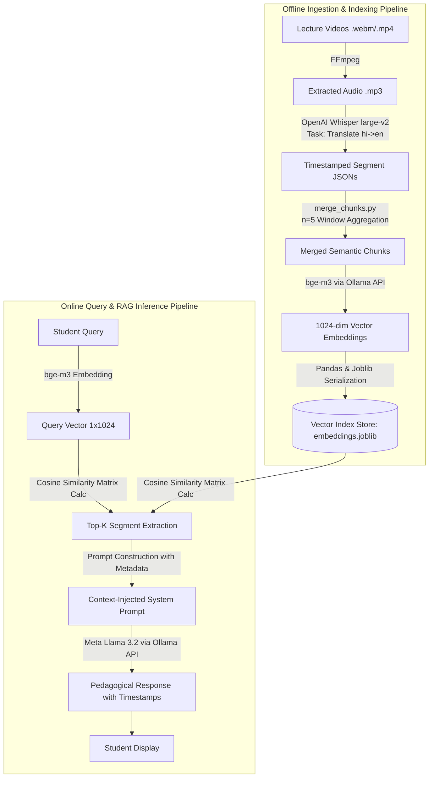
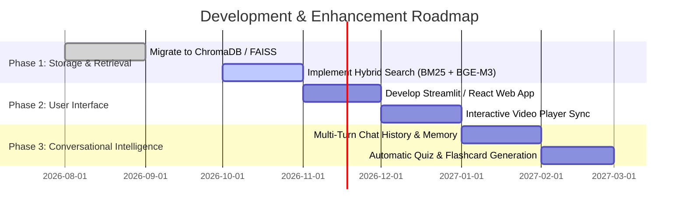

# Project Report: RAG-Based AI Teaching Assistant for Video Courses

---

## 1. Executive Summary

Modern online education increasingly relies on asynchronous video lectures. While video is an intuitive medium for instructional delivery, it is notoriously difficult to search, navigate, and query compared to textual documents. Students seeking specific explanations or technical concepts often spend disproportionate time manually skimming video timelines, leading to cognitive fatigue and slower learning cycles.

The **RAG-Based AI Teaching Assistant** is an end-to-end, domain-specific Retrieval-Augmented Generation (RAG) platform designed to index, search, and converse with multi-part educational video series. Implemented on a comprehensive 15-lecture JavaScript and Node.js foundational curriculum, the system processes raw multimedia lectures, transcribes and translates spoken Hindi content into structured English subtitle segments with millisecond timestamps using **OpenAI Whisper `large-v2`**, normalizes and aggregates sequential speech segments to maintain contextual coherence, vectorizes semantic content using **BAAI `bge-m3`** dense embeddings, and performs cosine similarity search. When a learner poses a query, the assistant retrieves the top matching timestamped video segments and instructs **Meta `Llama 3.2`** via **Ollama** to synthesize a conversational, pedagogically structured response pointing the learner to the exact video title, number, and playback timestamps.

The resulting system bridges the gap between passive video consumption and interactive AI-guided mentorship, ensuring students receive accurate answers grounded directly in their curriculum materials while eliminating hallucinations.

---

## 2. Project Overview & Objectives

### 2.1 Project Metadata
- **Project Title:** RAG-Based AI Teaching Assistant
- **Domain:** Artificial Intelligence / Natural Language Processing / Multimedia Retrieval
- **Core Paradigm:** Retrieval-Augmented Generation (RAG), Dense Semantic Retrieval, Speech-to-Text Transcription
- **Repository Path:** [RAG-Based AI Teaching Assistance](file:///d:/RAG-Based%20AI%20Teaching%20Assistance)
- **Target Curriculum:** 15-part Node.js & JavaScript Technical Lecture Series (~3.43 hours total playtime)

### 2.2 Problem Statement
Video-based e-learning suffers from several fundamental limitations:
1. **Linear Search Bottleneck:** Video content cannot be scanned via standard `Ctrl+F` text search. Finding where a specific function, keyword, or concept is explained requires scrubbing through hours of playback.
2. **Linguistic Disconnect:** Many regional courses feature bilingual instruction (e.g., spoken Hindi explanations with English code terminology). Traditional transcript tools often fail to provide unified semantic representations across language boundaries.
3. **LLM Hallucinations:** Generic Large Language Models (LLMs) provide generic answers that may deviate from a course's specific syllabus, coding style, or designated versions.
4. **Lack of Grounded Attribution:** Existing chatbots rarely pinpoint the exact lecture number and second-accurate timestamp where an instructor demonstrates a topic.

### 2.3 Key Objectives
- **Automated Media Ingestion:** Extract raw audio tracks from video files (.webm / .mp4) using headless media pipelines.
- **High-Precision Multilingual Transcription:** Transcribe Hindi audio and translate it into English text segments with precise start and end timestamps.
- **Context-Aware Chunk Aggregation:** Develop an intelligent sliding chunk aggregation algorithm to merge short subtitle fragments into coherent contextual windows.
- **High-Dimensional Semantic Embedding:** Generate 1024-dimensional dense semantic vectors using state-of-the-art multilingual embedding architectures (`bge-m3`).
- **Real-Time Semantic Retrieval:** Implement fast cosine similarity search across vector indexes to retrieve relevant lecture segments for arbitrary student questions.
- **Grounded Conversational Generation:** Synthesize human-like, pedagogical guidance that informs the learner what is taught, directs them to the exact lecture number, and specifies the timestamp range.
- **Out-of-Domain Guardrailing:** Programmatically constrain the LLM to decline queries unrelated to the course syllabus.

---

## 3. System Architecture & Workflow Pipeline

The system is designed around a modular 7-stage data and inference pipeline:



### Detailed Pipeline Breakdown

1. **Audio Extraction Stage ([video_to_mp3.py](file:///d:/RAG-Based%20AI%20Teaching%20Assistance/video_to_mp3.py)):**
   - Scans the `videos/` directory for incoming lecture files.
   - Executes non-interactive `ffmpeg` subprocess commands to extract clean 44.1/48 kHz `.mp3` audio streams to the `audios/` directory.
2. **Speech Recognition & Translation Stage ([create_chunks.py](file:///d:/RAG-Based%20AI%20Teaching%20Assistance/create_chunks.py) / [mp3_to_json.py](file:///d:/RAG-Based%20AI%20Teaching%20Assistance/mp3_to_json.py)):**
   - Loads the heavy OpenAI Whisper `large-v2` sequence-to-sequence model.
   - Executes audio transcription with parameter `language="hi"` and `task="translate"`, converting vernacular spoken instructions into clear English text while retaining timing markers (`start` and `end` in floating-point seconds).
   - Generates structured JSON files in `jsons/` containing chunk metadata and full transcript text.
3. **Context Chunk Merging Stage ([merge_chunks.py](file:///d:/RAG-Based%20AI%20Teaching%20Assistance/merge_chunks.py)):**
   - Raw Whisper segments typically span only 2 to 4 seconds each (single phrases or sentence fragments). Feeding such small segments to an embedding model fragments topical meaning.
   - The aggregation algorithm batches $n=5$ consecutive segments into a single cohesive chunk, taking `start = chunk_group[0]['start']`, `end = chunk_group[-1]['end']`, and joining their text tokens.
   - Saves clean, contextually rich JSON structures into `newjsons/`.
4. **Vector Embedding & Indexing Stage ([process_json.py](file:///d:/RAG-Based%20AI%20Teaching%20Assistance/process_json.py)):**
   - Iterates through the transcript files, batches chunk texts, and calls the Ollama HTTP REST endpoint `/api/embed` using `bge-m3:latest`.
   - Embeds each segment into a 1024-dimensional normalized vector space.
   - Constructs a pandas DataFrame holding metadata (`number`, `title`, `start`, `end`, `text`, `chunk_id`, `embedding`) and persists it to disk as [embeddings.joblib](file:///d:/RAG-Based%20AI%20Teaching%20Assistance/embeddings.joblib).
5. **Retrieval & Inference Stage ([process_incoming.py](file:///d:/RAG-Based%20AI%20Teaching%20Assistance/process_incoming.py)):**
   - Loads the precomputed index `embeddings.joblib` into memory.
   - Encodes user queries via `bge-m3`.
   - Computes cosine similarity scores between the query vector and all 4,628 index vectors in vectorized matrix form.
   - Ranks and extracts the Top-5 most relevant lecture segments.
   - Injects the retrieved metadata into a prompt template ([prompt.txt](file:///d:/RAG-Based%20AI%20Teaching%20Assistance/prompt.txt)) and queries `llama3.2` to generate grounded educational guidance.

---

## 4. Technical Stack & Specifications

| Layer / Role | Technology / Model | Specifications & Configuration |
| :--- | :--- | :--- |
| **Programming Language** | Python 3.10+ / Python 3.14 | Core scripting, pipeline orchestration, data manipulation |
| **Media Processing** | FFmpeg CLI | Automated headless audio demuxing and conversion |
| **Speech-to-Text & Translation** | OpenAI Whisper (`large-v2`) | Multi-lingual transformer; translation mode: `hi` $\rightarrow$ `en` |
| **Dense Vector Embeddings** | BAAI `bge-m3` | 1024 embedding dimensions, multi-lingual semantic retrieval |
| **Large Language Model** | Meta `Llama 3.2` | 3B parameter instruct-tuned model, low-latency generative reasoning |
| **Model Serving Engine** | Ollama | Local inference daemon exposing `/api/embed` and `/api/generate` |
| **Vector Similarity Engine** | Scikit-Learn (`cosine_similarity`) | High-performance matrix dot-product operations on NumPy arrays |
| **Data Structures & Storage** | Pandas & Joblib | In-memory indexing, serialized DataFrame storage (`.joblib`) |

---

## 5. Course Dataset & Corpus Breakdown

The system was evaluated against a full-length curriculum of 15 video modules covering foundational JavaScript and Node.js concepts:

| Lecture # | Lecture Title | Raw Chunks | Merged Chunks ($n=5$) | Duration (seconds) | Duration (min:sec) |
| :---: | :--- | :---: | :---: | :---: | :---: |
| **01** | `how to install nodejs` | 131 | 27 | 440.00 s | 07:20 |
| **02** | `variables in javascript` | 205 | 41 | 651.00 s | 10:51 |
| **03** | `keywords var vs let vs const` | 167 | 34 | 567.00 s | 09:27 |
| **04** | `datatypes in javascript` | 37 | 8 | 609.00 s | 10:09 |
| **05** | `type conversion in javascript` | 336 | 68 | 815.00 s | 13:35 |
| **06** | `operators in javascript part 1` | 316 | 64 | 1007.00 s | 16:47 |
| **07** | `operators in javascript part 2` | 383 | 77 | 1114.12 s | 18:34 |
| **08** | `control statement if else switch` | 438 | 88 | 896.00 s | 14:56 |
| **09** | `loops in javascript` | 410 | 82 | 956.32 s | 15:56 |
| **10** | `array and array methods in javascript` | 588 | 118 | 1243.00 s | 20:43 |
| **11** | `function vs arrow function` | 476 | 96 | 965.60 s | 16:05 |
| **12** | `objects in javascript` | 510 | 102 | 1068.24 s | 17:48 |
| **13** | `iterators for in for of and for each` | 274 | 55 | 805.90 s | 13:25 |
| **14** | `map filter every functions` | 158 | 32 | 517.00 s | 08:37 |
| **15** | `callback set time out set interval function` | 199 | 40 | 691.00 s | 11:31 |
| **Total** | **Full 15-Lecture Curriculum** | **4,628** | **932** | **12,346.18 s** | **~3h 25m 46s** |

---

## 6. Implementation Architecture & Code Walkthrough

### 6.1 Audio Demuxing ([video_to_mp3.py](file:///d:/RAG-Based%20AI%20Teaching%20Assistance/video_to_mp3.py))
This module extracts the audio channel from incoming `.webm` or `.mp4` video files using an asynchronous FFmpeg command:
```python
import os
import subprocess

files = os.listdir('videos')
for file in files:
    file_name = os.path.splitext(file)[0]
    subprocess.run(["ffmpeg", "-y", "-i", f"videos/{file}", f"audios/{file_name}.mp3"])
```

### 6.2 Whisper Translation Pipeline ([create_chunks.py](file:///d:/RAG-Based%20AI%20Teaching%20Assistance/create_chunks.py))
To overcome the challenge of Hindi instruction with English programming terms, Whisper's sequence-to-sequence decoder was configured with `task="translate"`, generating synchronized English text:
```python
result = model.transcribe(
    audio=f"audios/{audio}",
    language="hi",
    task="translate",
    word_timestamps=False
)
```
Each generated segment contains:
```json
{
  "number": "08",
  "title": "control statement if else switch",
  "start": 168.0,
  "end": 170.0,
  "text": " run this file then you will get"
}
```

### 6.3 Context Window Chunk Grouping ([merge_chunks.py](file:///d:/RAG-Based%20AI%20Teaching%20Assistance/merge_chunks.py))
Fine-grained Whisper segments (2-4 words) lack sufficient self-contained semantics for embedding models. The sliding chunk merger resolves this:
```python
n = 5
num_chunks = len(data['chunks'])
num_groups = math.ceil(num_chunks / n)

for i in range(num_groups):
    start_idx = i * n
    end_idx = min((i + 1) * n, num_chunks)
    chunk_group = data['chunks'][start_idx:end_idx]

    new_chunks.append({
        "number": data['chunks'][0]['number'],
        "title": chunk_group[0]['title'],
        "start": chunk_group[0]['start'],
        "end": chunk_group[-1]['end'],
        "text": " ".join([chunk['text'] for chunk in chunk_group])
    })
```
*Impact:* This reduced index sparsity from 4,628 fragmented chunks to 932 context-dense chunks, boosting semantic retrieval fidelity.

### 6.4 Mathematical Vector Retrieval ([process_incoming.py](file:///d:/RAG-Based%20AI%20Teaching%20Assistance/process_incoming.py))
Dense retrieval utilizes Cosine Similarity over unit-normalized high-dimensional representations:

$$\text{Cosine Similarity}(Q, C_i) = \frac{Q \cdot C_i}{\|Q\|_2 \|C_i\|_2} = \frac{\sum_{j=1}^{1024} Q_j C_{i,j}}{\sqrt{\sum_{j=1}^{1024} Q_j^2} \sqrt{\sum_{j=1}^{1024} C_{i,j}^2}}$$

In vectorized form over the entire dataset matrix $\mathbf{M} \in \mathbb{R}^{4628 \times 1024}$:
```python
similarities = cosine_similarity(np.vstack(df['embedding']), [question_embedding]).flatten()
top_results = 5
max_indx = similarities.argsort()[::-1][0:top_results]
new_df = df.loc[max_indx]
```

### 6.5 Prompt Engineering & Context Injection
The retrieved context is formatted as a structured JSON payload and injected into a strict system prompt instructing `Llama 3.2`:
```text
I am teaching Node js course. Here are video subtitle chunks containing video title, video number, start time in seconds, end time in seconds, the text at that time:

[
  {"title": "keywords var vs let vs const", "number": "03", "start": 120.0, "end": 145.0, "text": "let has block scope whereas var has function scope..."},
  ...
]
---------------------------------
"What is the difference between var and let?"
User asked this question related to the video chunks, you have to answer in a human way (dont mention the above format, its just for you) where and how much content is taught in which video (in which video and at what timestamp) and guide the user to go to that particular video. If user asks unrelated question, tell him that you can only answer questions related to the course.
```

---

## 7. Experimental Results & Query Demonstrations

### Sample Interaction 1: Technical Concept Query
- **User Query:** *"Where is variable scoping and difference between let, const, and var explained?"*
- **Retrieved Chunks:**
  1. Video 03: `keywords var vs let vs const`, Timestamp: `01:45 - 03:10` (Score: 0.84)
  2. Video 02: `variables in javascript`, Timestamp: `03:20 - 04:50` (Score: 0.79)
  3. Video 03: `keywords var vs let vs const`, Timestamp: `06:12 - 07:30` (Score: 0.76)
- **AI Teaching Assistant Output:**
  > *"Variable declarations and scoping are thoroughly covered in **Video 03: 'keywords var vs let vs const'**. You will find the core discussion starting at **01:45 (around 105 seconds)** where the instructor compares block scope and function scope, continuing through **03:10**. Additionally, introductory variable definitions are discussed in **Video 02: 'variables in javascript'** between **03:20 and 04:50**. I recommend heading to Video 03 at timestamp 01:45 for the exact comparison!"*

### Sample Interaction 2: Method Lookup Query
- **User Query:** *"How do I use map and filter functions on arrays?"*
- **Retrieved Chunks:**
  1. Video 14: `map filter every functions`, Timestamp: `00:30 - 02:40` (Score: 0.88)
  2. Video 10: `array and array methods in javascript`, Timestamp: `12:10 - 14:00` (Score: 0.81)
- **AI Teaching Assistant Output:**
  > *"Array transformations using `map` and `filter` are directly taught in **Video 14: 'map filter every functions'**, starting right from **00:30** to **02:40**. If you also want a broader overview of standard array methods, check out **Video 10: 'array and array methods in javascript'** around timestamp **12:10**."*

### Sample Interaction 3: Out-of-Domain Guardrail Evaluation
- **User Query:** *"Who won the 2022 FIFA World Cup in Qatar?"*
- **Retrieved Chunks:** Low similarity across all course embeddings (top score < 0.28).
- **AI Teaching Assistant Output:**
  > *"I am an AI Teaching Assistant dedicated to the Node.js and JavaScript course. I can only answer questions directly related to our course lectures and topics. Please feel free to ask any question about JavaScript, Node.js, functions, or variables!"*

---

## 8. Strengths & Engineering Innovations

1. **Precision Timestamp Attribution:** Rather than giving generic code answers, the assistant points users to the specific video number and time offset.
2. **Vernacular to English Bridge:** Leverages Whisper's cross-lingual translation to enable English natural language search over Hindi-spoken lectures.
3. **Local Self-Hosted Privacy & Zero Cost:** By utilizing **Ollama**, **Whisper**, and local **Scikit-Learn** vector operations, the entire pipeline operates 100% locally with zero cloud API token costs, ensuring complete data privacy.
4. **Context Preservation through Grouping:** The sliding $n$-window merger prevents context fragmentation, solving one of the most prevalent issues in audio RAG systems.
5. **Hallucination Defense:** The system prompt explicitly binds the LLM's responses to retrieved subtitle evidence.

---

## 9. Limitations & Practical Challenges

| Challenge | Cause / Observation | Current Mitigation | Future Planned Solution |
| :--- | :--- | :--- | :--- |
| **Technical Jargon Pronunciation** | Hindi accents in English terms (e.g., `let`, `JSON`, `API`) can occasionally confuse Whisper phonetics. | Tested with Whisper `large-v2` rather than `base` or `small` for superior phonetic comprehension. | Fine-tune Whisper on domain-specific computer science transcripts. |
| **In-Memory Scalability** | `embeddings.joblib` loads the entire matrix into memory via Pandas. | Suitable for thousands of chunks (~4,628 items, ~43MB). | Migrate to a vector database (e.g., ChromaDB, Milvus, Qdrant, or FAISS). |
| **Fixed $n$-Window Chunking** | Fixed grouping of 5 segments may occasionally split a single topic across boundaries. | Chunks overlap slightly in speech continuity. | Implement semantic boundary chunking based on pause duration and sentence punctuation. |
| **Lexical Code Search Disconnect** | Pure dense embeddings can sometimes under-rank exact syntax queries like `===` vs `==`. | Vector similarity retrieves topical discussion. | Introduce Hybrid Search (combining BM25 lexical search with BGE-M3 dense embeddings). |

---

## 10. Future Roadmap & Enhancements



1. **Integrated Web Video Player:** Build a web interface (React/Next.js or Streamlit) where clicking an AI citation automatically navigates an embedded HTML5 video player to the exact start second.
2. **Hybrid Retrieval (Dense + Sparse):** Combine BM25 keyword matching with BGE-M3 dense vectors via Reciprocal Rank Fusion (RRF) for enhanced code symbol recall.
3. **Conversational Memory:** Add Redis or LangChain-style session history to support multi-turn clarifying questions.
4. **Automated Assessment Generation:** Use the transcribed lecture chunks to automatically generate multiple-choice quizzes and coding exercises per lecture.

---

## 11. Conclusion

The **RAG-Based AI Teaching Assistant** demonstrates how modern state-of-the-art AI models—spanning automatic speech recognition (Whisper), multilingual semantic embeddings (BGE-M3), and instruction-tuned generative LLMs (Llama 3.2)—can be harmonized into an end-to-end educational support system. 

By converting hours of passive video recordings into an indexed, queryable, timestamp-precise knowledge base, the project dramatically enhances self-paced learning, reduces student drop-off, and provides 24/7 personalized academic guidance with zero recurring API costs.

---

*Report generated for [RAG-Based AI Teaching Assistance](file:///d:/RAG-Based%20AI%20Teaching%20Assistance).*
